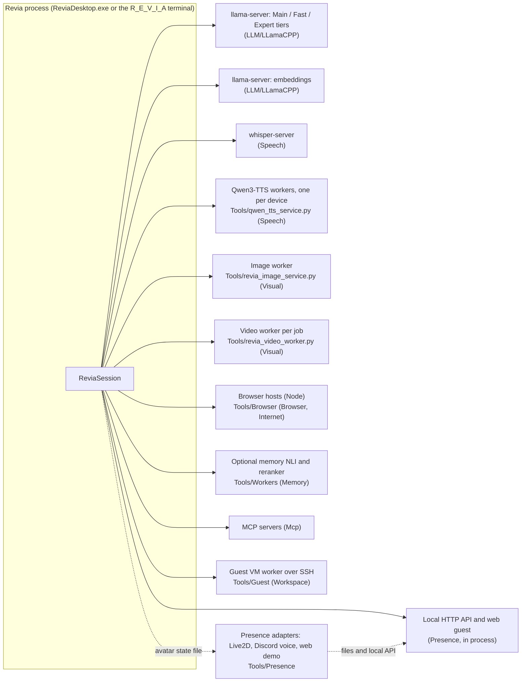
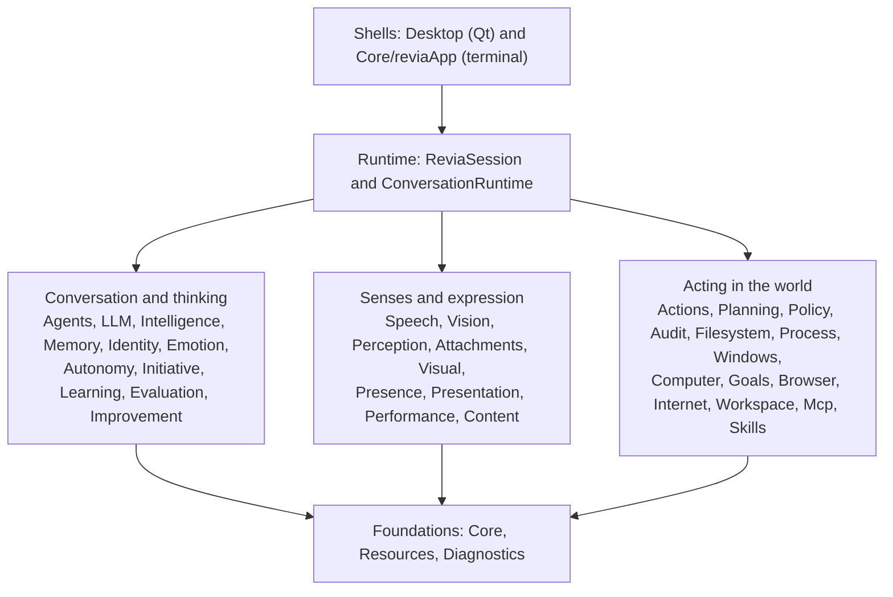

# Revia code map

The complete map of the codebase: what each part does, where it lives, how the parts connect, and
why they exist. It covers every tracked file. Pass 1 of the improvement work: it records what is,
not what should change. The measured observations at the end are the input for pass 2.

Generated at commit `510b838` from hand-written descriptions plus measured facts (line counts,
`#include` dependencies). For the reasoning behind the design, the invariants and the turn path in
detail, read [ARCHITECTURE.md](ARCHITECTURE.md); this map links into it rather than repeating it.

Regenerate it with `python Tools/CodeMap/build_code_map.py` after changing code; the descriptions
live in `Tools/CodeMap/descriptions.py`. The generator refuses to write the map while any tracked
file lacks a description, and `--check` reports a stale map.

## Contents

1. [How to read this map](#how-to-read-this-map)
2. [The big picture](#the-big-picture)
3. [Where data lives](#where-data-lives)
4. [Subsystems](#subsystems), by layer
5. [Desktop shell](#desktop-shell)
6. [Tools and services](#tools-and-services)
7. [Tests](#tests)
8. [Configuration, assets, build and CI](#configuration-assets-build-and-ci)
9. [Measured observations for pass 2](#measured-observations-for-pass-2)

## How to read this map

- **Unit.** `Public/<Domain>/x.h` declares a contract and `Private/<Domain>/x.cpp` implements it;
  the map lists them as one unit, `<Domain>/x`. A unit with only a header is a value type or
  settings struct. Desktop `.h`/`.cpp` pairs are one unit too.
- **Lines** are physical lines of the unit's files at `510b838`.
- **Depends on / used by** come from `#include` lines between domains. They show compile-time
  coupling, which is a good proxy for "knows about".
- The code is C++20 with Qt 6 for the desktop. Python, Node and PowerShell appear only in `Tools`
  (workers, adapters, setup) and their tests.

Size at a glance: 319,089 lines of code in 1,128 files.
Production C++ is 161,086 lines in 388 units across 38 domains; the Qt desktop
26,840; tests 107,129; tools 24,021.

## The big picture

Revia is a local companion: a desktop application that talks (typed and spoken), sees (screen,
camera, uploaded media), remembers, has a persistent personality and emotions, and can act on the
computer within explicit permissions. Models run locally through llama.cpp and Python workers that
Revia starts and owns; a cloud model is optional.

### Processes

Revia is one native process that owns several child processes. Every child listens only on
loopback and is started, supervised and stopped by a C++ owner.

### Layers inside the process

This is the intended shape. The include graph shows where the code departs from it; see the
[measured observations](#measured-observations-for-pass-2).

### One conversation turn, in brief

1. The shell calls `ReviaSession` (typed text, a transcript, an adapter message).
2. `InputArbiter` merges and orders input into a batch; the session admits one foreground
   operation and builds its task contract.
3. `ConversationRuntime` routes the turn: `IntelligenceRouter` picks a tier, and grounding is
   gathered (memory, recall, files, internet lookup, arithmetic, saved source).
4. `TurnCoordinator` runs `ConversationAgent` through `messageRouter` to `llamaCppService`, which
   fits the prompt and streams the reply. The tool loop executes chat tools through
   `ActionRuntime`, so policy and audit still apply.
5. The reply is filtered (`responseFilter`, style policy), shown, and spoken sentence by sentence
   (`speechService`), while emotion, identity and presence are updated.
6. Afterwards the `MemoryAgent` evaluates the turn in the background and may store memories.

The full path with diagrams is in [ARCHITECTURE.md, Current turn path](ARCHITECTURE.md#current-turn-path).

### Every side effect, the same way

`Planning` turns words into a typed `ActionRequest`. `Policy` evaluates risk and permission;
`Actions` asks for confirmation if needed and dispatches it to one narrow executor (`Filesystem`,
`Process`, `Windows`, `Browser`, `Internet`, `Visual`, `Workspace`). `Audit` records intent before
and result after. Chat tools, goals, computer control, skills and MCP all reuse this path. See
[ARCHITECTURE.md, Trust boundary](ARCHITECTURE.md#trust-boundary).

## Where data lives

| Location | Contents | Owner |
| --- | --- | --- |
| `Config/` (tracked) | Default settings, capabilities, profiles, model manifest, evaluation corpora, starter voice | `Core/configManager`, `Policy/permissionStore` |
| `RuntimeData/Companions/registry.json` | Which companions exist and which is selected | `Runtime/companion` |
| Each companion's root | That companion's `RuntimeData` tree, `Memory/revia_memory.db`, `Memory/revia_conversations.db`, `Goals/revia_goals.db`, logs | `Runtime/companion` |
| `RuntimeData/Settings/owner-settings.json` | The owner's overrides over `Config/settings.json` | `Core/settingsFileEditor` |
| `RuntimeData/Preferences/` | Non-authority user preferences | `Core/preferenceStore` |
| `RuntimeData/Identity/identity.json` | Development, preferences, relationships | `Identity/identityStore` |
| `RuntimeData/Agents/` | Agent Studio workflow, provider, tool scope, delegation | `Runtime/agentStudioRuntime`, `Runtime/sessionDelegation` |
| `RuntimeData/Learning/` | Lesson records, kept captures, corrections, dataset lineage | `Learning/*` |
| `RuntimeData/Voices/`, `Songs/`, `Images/`, `Diagrams/`, `Camera/`, `Vision/` | Voices and presets, songs, generated media, captures | Speech, Performance, Visual, Vision |
| `RuntimeData/Presence/` (`Inbox`, `Outbox`, avatar state) | Adapter traffic and the avatar file renderers read | `Presence/presenceRuntime` |
| `RuntimeData/Improvement/`, `Evaluations/`, `ComputerExperience/`, `Skills/`, `Reminders/`, `Browser/Profile`, `VirtualMachine/`, `LocalApi/` | Proposals and workbench, evaluation runs, recorded experiences, skill packages, reminders, private browser profile, guest VM settings, local API token | the matching domain |

`Runtime/runtimeDataBootstrap` creates this layout on first run without overwriting anything.

## Subsystems

### Orchestration

#### Runtime

The orchestration layer. `ReviaSession` is the one lifecycle owner both the Qt desktop and the
terminal use: it starts and stops every service and child process, admits one foreground
operation at a time, publishes `RuntimeEvent`s to whatever shell is attached, and composes all
the other owners. Its implementation is split across many `session*.cpp` files that all implement
the same class (delegation, speech, settings, resources, editor awareness and so on).
`ConversationRuntime` owns an admitted conversation turn from routing to delivered reply.
The studios (`agentStudioRuntime`, `audienceStudio`, `learningStudio`, `developmentStudio`) are the
session-side halves of the desktop's studio panels. Why it exists: one owner means desktop and
CLI can never drift apart, and every side effect passes through the same admission and audit.

26,273 lines in 41 units. **Depends on:** Actions, Agents, Attachments, Audit, Autonomy, Browser, Computer, Content, Core, Diagnostics, Emotion, Evaluation, Goals, Identity, Improvement, Initiative, Intelligence, Internet, LLM, Learning, Mcp, Memory, Perception, Performance, Planning, Policy, Presence, Presentation, Resources, Skills, Speech, Vision, Visual, Windows, Workspace. **Used by:** Actions, Agents, Audit, Browser, Core, Emotion, Goals, Improvement, Intelligence, Learning, Memory, Policy, Presence, Presentation, Process, Resources, Skills, Speech.

| Unit | Lines | What it does |
| --- | ---: | --- |
| `Runtime/reviaSession` | 13,182 | The session: lifecycle owner of every service, child process and worker; one foreground operation at a time; publishes runtime events; the API every shell calls. |
| `Runtime/conversationRuntime` | 3,230 | Runs one admitted conversation turn: routing and tier choice, grounding (memory, recall, internet, arithmetic, files), prompt assembly, tool loop, streamed reply, speech and timing. |
| `Runtime/sessionDelegation` | 1,034 | Chat delegation: hands one bounded investigation from a conversation to Agent Studio and reports the reviewed outcome back through Revia's own reply. |
| `Runtime/agentStudioRuntime` | 843 | Session side of Agent Studio: starts, resumes, advances, retries and cancels multi-agent workflows, persists them, and provides the model provider workers call (including yielding to the conversation). |
| `Runtime/companion` | 770 | Companion registry and paths: each companion's own RuntimeData root, creation, selection and migration of the legacy single-companion layout. |
| `Runtime/sessionSettings` | 757 | Settings dialog backend: owner overlay over settings.json, live appliers, workspace and session-only switches. |
| `Runtime/affectController` | 602 | The affect state machine: observes input, turns and runtime-confirmed internal events, classifies them and settles over time, so emotion can shape the current reply. |
| `Runtime/documentWorkshop` | 601 | Working document and visuals for a turn: compose and revise document blocks, undo, generate or show images, draw diagrams. |
| `Runtime/qualityFeedback` | 538 | Owner judgments of replies: records feedback, keeps the exact exchange for training on request, corrections, withdrawal, live dataset export, and owner memory revisions. |
| `Runtime/developmentStudio` | 396 | Session side of Development Studio: bounded, validated proposals to change Revia's own presentation files, with evidence and review. |
| `Runtime/conversationSessions` | 394 | Conversation history operations: browse, open, continue, rename, delete, regenerate, retry and edit the last exchange. |
| `Runtime/learningStudio` | 327 | Snapshot for the Skills & Learning panel: lesson candidates, kept training captures and their corrections. |
| `Runtime/sessionSpeech` | 317 | Adapts speech service events to session state, diagnostics, voice health and system cues. |
| `Runtime/sessionEditorAwareness` | 293 | Editor awareness: observes saved source files from the editor bridge and supplies the current saved-file context to turns. |
| `Runtime/runtimeEvents` | 268 | RuntimeState, RuntimeEvent and the thread-safe event bus every shell and panel subscribes to. |
| `Runtime/audienceStudio` | 247 | Session side of Audience Studio: who Revia is talking to, speaker enrollment and forgetting, evidence corrections and display aliases. |
| `Runtime/sessionResources` | 240 | Resource monitor wiring: live load sampling and the resource status shown to the user. |
| `Runtime/responseLatency` | 239 | Measures response latency per turn (text, first audio, first playback) with medians and p95. |
| `Runtime/sessionTaskContracts` | 195 | Builds and validates the task contract for each admitted turn and action. |
| `Runtime/sessionOperator` | 189 | Wires operator (computer-control) callbacks and enriches desktop observations for it. |
| `Runtime/investigationChecks` | 175 | Executes one bounded investigation check through the action runtime with admission. |
| `Runtime/runtimeDataBootstrap` | 164 | First-run layout: creates RuntimeData directories and copies starter assets without overwriting anything the user has. |
| `Runtime/sessionVideoGeneration` | 156 | Starts a local video generation job and publishes its result. |
| `Runtime/outputChannelPolicy` | 148 | Decides whether a reply is spoken on the current output channel, and why. |
| `Runtime/turnContext` | 123 | Immutable TurnContext (what one unit of work may know) and the turn outcome/event types. |
| `Runtime/companionSettings` | 106 | Binds a companion's settings and log directory when it is selected. |
| `Runtime/speakerEnrollmentRuntime` | 105 | Session wiring for voice speaker enrollment (start, cancel, capture samples, resolve speakers). |
| `Runtime/sessionIdentity` | 88 | Issues and invalidates the session's RuntimeStamp so late work from a previous session is refused. |
| `Runtime/idleComputerActivity` | 79 | Executes an approved idle computer activity (explore or make something in an approved scope). |
| `Runtime/sessionLocalApi` | 79 | Starts the local HTTP API that external programs use, authenticated by the install's token. |
| `Runtime/internalStimulus` | 68 | Typed internal outcomes (task succeeded, failed, ...) that may produce affect only once the runtime confirms them. |
| `Runtime/affectTypes` | 51 | Value types for affect: state, snapshot and social context. |
| `Runtime/sessionResult` | 50 | The result of one interaction returned to a shell (text, success, reason...). |
| `Runtime/sessionMcp` | 48 | Exposes configured MCP servers' tools to chat, journaled like every action. |
| `Runtime/publicContextCache` | 45 | Eviction choice for the bounded per-audience public conversation cache. |
| `Runtime/retainedCounts` | 37 | Counts warnings and errors still retained in a bounded log. |
| `Runtime/runtimeStamp` | 25 | Stamp carried by work: companion, session, generation, task, attempt and policy version; used to reject stale work. |
| `Runtime/videoPublicationLane` | 23 | Serializes publication of generated videos so shutdown can own the lane. |
| `Runtime/channelSettings` | 17 | Per-channel conversation settings, such as executables Revia may speak for. |
| `Runtime/agentProviderMode` | 14 | Which provider agent workers use: demonstration, local, local with tools. |
| `Runtime/outputChannel` | 10 | Where a reply is going (enum). |

### Conversation and thinking

#### Agents

The conversation and its helpers. `TurnCoordinator` runs the `ConversationAgent` for a turn and
queues the `MemoryAgent`'s background work afterwards. Around them: input arbitration (merging
typed and spoken input), the response filter and style policy, reply streaming and fragmenting
for speech, the tool loop and tool registry for chat tools, self-inquiry and investigation agents,
the Agent Studio workflow engine (`agentWorkflow`), source-code review and diagnostics, and
grounding helpers (arithmetic, reminders, reply formats). Why: everything that decides what Revia
says, separated from the session that decides whether she may say it.

16,368 lines in 36 units. **Depends on:** Actions, Audit, Core, Evaluation, Identity, Intelligence, LLM, Memory, Perception, Planning, Policy, Runtime, Speech, Workspace. **Used by:** Autonomy, Core, Evaluation, LLM, Mcp, Memory, Runtime.

| Unit | Lines | What it does |
| --- | ---: | --- |
| `Agents/agentWorkflow` | 1,693 | The Agent Studio engine: parent/worker/review nodes, budgets, attempts, artifacts, acceptance and persistence. |
| `Agents/memoryAgent` | 1,534 | Background memory worker: evaluates finished turns for memories, embeddings backfill, learned findings, owner revisions; queues and priorities. |
| `Agents/sandboxTools` | 1,321 | Sandbox tools for workers: workspace projects, grep, read, patch, run tests and Python in a private sandbox. |
| `Agents/conversationStylePolicy` | 1,298 | Turn guidance and reply refinement: brevity, corrections, acknowledgements, answer obligation, streaming rules. |
| `Agents/investigation` | 1,181 | Investigation state: questions, hypotheses, checks, findings, budget and outcome. |
| `Agents/responseFilter` | 824 | Hard and AI response filters applied to replies, including streamed prefixes. |
| `Agents/selfInquiry` | 740 | Self-inquiry: when Revia asks herself questions before answering, with limits and transcript. |
| `Agents/toolRegistry` | 733 | The registry of chat tools and their permissions, executors and argument validation. |
| `Agents/replyFormat` | 732 | Requested reply formats and contracts (JSON, lists, sentence counts) and matching. |
| `Agents/sourceDiagnostic` | 642 | Static diagnostics over a saved source file (likely bugs a native observation can mention). |
| `Agents/investigationAgent` | 572 | Runs investigation rounds with the model: opening questions, checks, parsing. |
| `Agents/calculationGrounding` | 477 | Restricted arithmetic grounding: asks the model for a calculation proposal and verifies it before it reaches the reply. |
| `Agents/curiosityAgent` | 467 | Nominates and parses idle curiosity activities. |
| `Agents/toolLoop` | 466 | Runs the chat tool loop: model asks for tools, tools execute through admission, results go back, with limits and audit. |
| `Agents/inputArbiter` | 450 | Merges, debounces and orders typed and spoken input into batches for the next turn. |
| `Agents/conversationQualityMonitor` | 341 | Watches delivered replies for known quality failures (stock tails, invented physical life, denials...). |
| `Agents/sourceQuotation` | 333 | Resolves exact quotations from saved source for replies. |
| `Agents/sourceDiagnosticReply` | 308 | Formats a source diagnostic as a reply and recognizes follow-ups. |
| `Agents/replyFragmenter` | 262 | Splits a streamed reply into speakable sentence fragments. |
| `Agents/compositionRequest` | 193 | Recognizes a self-contained composition request (story, poem...) that needs no grounding. |
| `Agents/agentDeliverable` | 192 | The required sections and evidence of an agent workflow's deliverable, and their validation. |
| `Agents/conversationAgent` | 189 | Generates the conversation reply for a turn through the router. |
| `Agents/agentToolWorker` | 179 | Schema and parsing for one bounded tool action proposed by an Agent Studio worker. |
| `Agents/delegation` | 161 | Delegation mode and the cue in the person's words that offers chat delegation. |
| `Agents/sourceReview` | 161 | Model review of saved source files, with parsing. |
| `Agents/turnCoordinator` | 159 | Runs a turn's conversation agent and owns the memory agent's queue. |
| `Agents/chatTools` | 157 | Chat tool bindings for actions, files and reminders. |
| `Agents/replyStreamGate` | 125 | Holds back a streamed reply until it is safe to release. |
| `Agents/responseProvenance` | 115 | Classifies whether a reply may express Revia's own opinion. |
| `Agents/sourceExplanationPolicy` | 104 | Recognizes requests to explain saved source code (which cap sampling). |
| `Agents/reasoningRelay` | 103 | Relays streamed model reasoning to an observer in bounded chunks. |
| `Agents/reminderIntent` | 62 | Detects whether a request asks for a reminder effect. |
| `Agents/conversationSettings` | 42 | Conversation settings (style, review, limits). |
| `Agents/inputArbiterSettings` | 26 | Input arbitration timing settings. |
| `Agents/answerObligation` | 15 | How strictly a reply must answer (balanced, reliable, character-first). |
| `Agents/responseFilterSettings` | 11 | Response filter settings. |

#### LLM

Model access. `llmService` fronts llama.cpp (`LLamaCPP/`) and the optional cloud provider
(`Cloud/`); `llamaCppService` builds every request (prompt fitting, tools, images, sampling) and
parses streamed replies; `llamaCppServerProcess` launches and supervises `llama-server` children
with a hardware plan; `inferenceScheduler` shares slots between interactive and background work
with preemption. Why: one place knows the wire protocol and the model processes, so the rest of
Revia talks in typed requests.

8,668 lines in 25 units. **Depends on:** Actions, Agents, Attachments, Audit, Core, Identity, Memory, Planning. **Used by:** Agents, Attachments, Computer, Core, Improvement, Learning, Mcp, Memory, Presence, Resources, Runtime, Speech.

| Unit | Lines | What it does |
| --- | ---: | --- |
| `LLM/LLamaCPP/llamaCppService` | 3,401 | The llama.cpp client: builds and sends every chat, planning, review, vision and memory request, fits prompts and parses streams. |
| `LLM/LLamaCPP/llamaCppServerProcess` | 818 | Launches and supervises llama-server children: hardware plan, arguments, batch settings, health. |
| `LLM/llmService` | 643 | Facade over the configured backend (llama.cpp or cloud). |
| `LLM/Cloud/cloudChatService` | 495 | Optional cloud chat provider: availability, persona, transport, audit, streamed responses. |
| `LLM/imagePromptGuidance` | 412 | Prompt guidance for uploaded images and sampled video frames. |
| `LLM/Cloud/cloudPolicy` | 374 | When a turn may go to the cloud, and building a payload with private context stripped. |
| `LLM/promptBuilder` | 365 | Builds prompt messages with memory blocks and retrieval queries. |
| `LLM/Cloud/cloudProtocol` | 348 | Cloud provider wire formats and the server-sent-event parser. |
| `LLM/LLamaCPP/llamaCppEmbeddingService` | 348 | Client for the dedicated embedding llama-server. |
| `LLM/Cloud/cloudTransport` | 342 | HTTPS transport for cloud requests. |
| `LLM/inferenceScheduler` | 241 | Shares llama.cpp slots: interactive first, background preemptible. |
| `LLM/videoFrameReply` | 219 | Schema and parsing for structured replies about sampled video frames. |
| `LLM/responseTypes` | 105 | Response, timing and prompt-fit report types. |
| `LLM/endpointSettings` | 103 | llama.cpp and embedding endpoint settings. |
| `LLM/tokenEstimate` | 96 | Token estimates and compaction to a token budget. |
| `LLM/LLamaCPP/cancellableHttpClient` | 84 | HTTP client whose in-flight request can be cancelled. |
| `LLM/toolCall` | 62 | Tool definition, call, result and round types for the wire. |
| `LLM/LLamaCPP/serverKeyProof` | 58 | Proves the running llama-server holds the expected API key. |
| `LLM/backendTypes` | 32 | Backend kind, system status and health result types. |
| `LLM/Cloud/cloudSettings` | 29 | Cloud model settings. |
| `LLM/providerExchange` | 28 | The exact request/response exchange kept for a judged reply. |
| `LLM/imageTokenBudget` | 26 | Token allowance for attached images. |
| `LLM/embeddingTypes` | 14 | Embedding result type. |
| `LLM/privateMemoryAccess` | 14 | Whether a request may read private memory. |
| `LLM/codeReviewPurpose` | 11 | Why a code review request is made. |

#### Intelligence

Which model answers, how hard it thinks, and which models stay loaded. The router picks a tier
(Reflex, Fast, Main, Expert, vision) from typed evidence; `modelLifetime` and
`modelResidencyManager` keep models resident or unload them under leases.

1,245 lines in 7 units. **Depends on:** Runtime. **Used by:** Agents, Core, Runtime.

| Unit | Lines | What it does |
| --- | ---: | --- |
| `Intelligence/modelLifetime` | 409 | Leases and idle sweeps that decide when a managed model may unload. |
| `Intelligence/intelligenceRouter` | 258 | Chooses the model tier and reasoning mode for a turn. |
| `Intelligence/modelResidencyManager` | 224 | Tracks which models are loading, ready, failed or unloaded. |
| `Intelligence/humanizationState` | 108 | Humanization state (mood persistence, curiosity, social energy, confidence, talkativeness...) updated from input and outcomes. |
| `Intelligence/reflexRouter` | 108 | Answers trivial turns instantly without a model (the Reflex tier). |
| `Intelligence/intelligenceTypes` | 90 | Tier, reasoning mode, routing context and decision types. |
| `Intelligence/intelligenceSettings` | 48 | Tier and intelligence settings. |

#### Memory

What Revia remembers. `longTermMemory` stores structured facts with vectors in SQLite and
ranks them with BM25 plus cosine similarity (`hybridRanking`); `conversationArchive` keeps every
conversation and its embeddings for recall; `conversationRecall` decides when a turn should look
back. Optional CPU workers rerank results (`memoryReranker`) and detect near-duplicate memories
(`memoryNliWorker`, `semanticDuplicate`). `sensitiveContent` refuses secrets before anything is
stored. Why: durable, attributable, privacy-scoped memory that the conversation can cite.

6,853 lines in 15 units. **Depends on:** Actions, Agents, Audit, Core, Identity, LLM, Process, Runtime. **Used by:** Agents, Attachments, Audit, Computer, Core, Goals, LLM, Learning, Runtime, Skills, Workspace.

| Unit | Lines | What it does |
| --- | ---: | --- |
| `Memory/conversationArchive` | 1,854 | SQLite archive of every conversation session and turn, with embeddings, recall search and session management. |
| `Memory/longTermMemory` | 1,686 | SQLite store of structured memories with embeddings, scoped loading, search, revisions and duplicate marks. |
| `Memory/temporalQuery` | 579 | Parses time expressions ('last Tuesday') into time windows for recall. |
| `Memory/sensitiveContent` | 565 | Detects secrets and sensitive content that must never be stored automatically. |
| `Memory/conversationRecall` | 431 | Decides when a turn should recall earlier conversation, builds the recall request and renders the block. |
| `Memory/memoryReranker` | 381 | Client for the optional local CPU reranker worker. |
| `Memory/memoryNliWorker` | 331 | Client for the optional local CPU entailment (NLI) worker. |
| `Memory/semanticDuplicate` | 224 | Semantic duplicate detection between memories using NLI scores. |
| `Memory/memoryReconciliation` | 219 | Classifies how a new memory relates to an existing one (duplicate, update, conflict...). |
| `Memory/hybridRanking` | 179 | FTS query building, cosine similarity and reciprocal-rank fusion. |
| `Memory/memoryCorrection` | 165 | Proposes corrections to stored memories from what the owner said. |
| `Memory/memoryScope` | 85 | Who a memory is about and which audience scope may read it. |
| `Memory/memoryRevision` | 59 | Owner memory revision request, receipt and scope lease. |
| `Memory/memoryTypes` | 50 | Memory entry, importance and decision types. |
| `Memory/memoryAttribution` | 45 | Whether a memory is about Revia herself and attributable to her. |

#### Identity

Who Revia is and who she knows. Persistent development (base personality plus learned
offsets), preferences, per-person relationships and the evidence that moves them, and the
canonical state packet given to every model tier. Saved atomically with schema versions.

3,683 lines in 12 units. **Depends on:** Actions, Core, Emotion, Speech. **Used by:** Agents, Attachments, Autonomy, Emotion, LLM, Learning, Memory, Runtime, Speech.

| Unit | Lines | What it does |
| --- | ---: | --- |
| `Identity/relationshipRegistry` | 849 | Per-person relationships: load, save, apply evidence, corrections, aliases, recognition consent. |
| `Identity/identityStore` | 584 | Atomic, versioned persistence of identity (development, preferences, relationships). |
| `Identity/preferenceState` | 361 | Revia's preferences: direction, strength, reinforcement and pruning. |
| `Identity/developmentState` | 318 | Trait vectors, baseline from the profile, drift and its description. |
| `Identity/relationshipEvidence` | 309 | Reads conversation signals (names, warmth, teasing) into relationship events. |
| `Identity/relationshipState` | 293 | One relationship's state and how events and time change it. |
| `Identity/statePacketRenderer` | 263 | Renders the state packet and emotion section as prompt text. |
| `Identity/developmentEngine` | 247 | Applies evidence from turns to slowly develop Revia's traits within limits. |
| `Identity/preferenceEvidence` | 193 | Reads evidence about Revia's preferences from work and curiosity outcomes. |
| `Identity/socialIdentity` | 100 | Audience, speaker and recognition-consent types. |
| `Identity/reviaStatePacket` | 92 | The canonical state packet (identity, memories, self-knowledge) for every model tier. |
| `Identity/promptMarkers` | 74 | Canonical state-packet section headers, shared by the renderers and by leak detection (Revia must not read them back out). |

#### Emotion

A continuous emotion vector with slow mood underneath. Stimuli confirmed by the runtime are
appraised (relevance, expectedness, control, social importance) into emotions that decay over
time and feed back into the next appraisal. Nothing here feels anything the runtime did not confirm.

1,832 lines in 9 units. **Depends on:** Core, Identity, Runtime. **Used by:** Autonomy, Identity, Runtime.

| Unit | Lines | What it does |
| --- | ---: | --- |
| `Emotion/emotionRuntime` | 419 | Runs appraisal, settling and mood, and projects emotion into affect. |
| `Emotion/emotionTypes` | 383 | Emotions, readings and the emotion vector with decay and valence. |
| `Emotion/emotionModel` | 291 | The emotion model interface and the rule-based default. |
| `Emotion/moodController` | 187 | Mood dynamics: how emotions move irritability, energy and sociability. |
| `Emotion/stimulusBuilder` | 166 | Builds stimuli from conversation, goals, discoveries and quiet periods. |
| `Emotion/appraisalEngine` | 150 | Derives appraisal dimensions from a stimulus and context. |
| `Emotion/moodState` | 81 | Mood state and its controller. |
| `Emotion/stimulus` | 79 | A typed stimulus and its source. |
| `Emotion/appraisalContext` | 76 | Context an appraisal uses (relevant memories, relationship, goals). |

#### Autonomy

Whether Revia has any reason to act on her own. Drives build up from evidence, an activity
scheduler weighs evidence against cost and the person's presence, and doing nothing is the normal
outcome. A timer alone never produces activity.

1,328 lines in 4 units. **Depends on:** Actions, Agents, Emotion, Identity. **Used by:** Runtime, Skills.

| Unit | Lines | What it does |
| --- | ---: | --- |
| `Autonomy/activityScheduler` | 448 | Decides whether to start an activity from evidence, cost and limits. |
| `Autonomy/activityExecution` | 411 | Resolves research topics and idle computer actions for an activity. |
| `Autonomy/driveState` | 374 | Drives (curiosity, boredom, social, unfinished goal, exploration, learning, creativity) and their dynamics. |
| `Autonomy/activity` | 95 | An autonomous activity, its type and status. |

#### Initiative

When Revia speaks first. Window events produce cues (focus stretch, return to an app, repeated
switching, a saved file); the attention policy applies confidence, input rhythm, full-screen,
cooldown and budget gates; the initiative controller decides and records outcomes.

1,960 lines in 5 units. **Depends on:** Audit, Core, Goals, Perception. **Used by:** Core, Learning, Runtime.

| Unit | Lines | What it does |
| --- | ---: | --- |
| `Initiative/initiativeController` | 686 | Considers proposals, decides to speak, and records responses. |
| `Initiative/attentionPolicy` | 459 | Gates whether interrupting now is acceptable (input rhythm, full screen, cooldown, budget). |
| `Initiative/curiosityJournal` | 410 | Remembers topics recently considered or researched. |
| `Initiative/conversationStarter` | 360 | Turns observed events into conversation cues. |
| `Initiative/initiativeSettings` | 45 | Initiative settings. |

#### Learning

Learning from outcomes, always through review. Lessons are proposed and need approval; judged
replies can be kept as training captures, corrected and exported as datasets for offline training;
self-assessment tracks capability gaps.

3,568 lines in 7 units. **Depends on:** Actions, Audit, Core, Goals, Identity, Initiative, LLM, Memory, Runtime. **Used by:** Improvement, Runtime.

| Unit | Lines | What it does |
| --- | ---: | --- |
| `Learning/selfAssessment` | 900 | Tracks capability gaps and proposes self-improvement tasks. |
| `Learning/liveCapture` | 794 | Kept exchanges of judged replies, their corrections and withdrawal. |
| `Learning/datasetExport` | 662 | Builds deterministic, provenance-bound training datasets (train/validation/test) from reviewed candidates. |
| `Learning/learningRecordStore` | 422 | Stores lesson candidates, checks and review decisions. |
| `Learning/liveDatasetExport` | 371 | Exports corrected live captures as numbered datasets of a lineage. |
| `Learning/qualityFeedback` | 212 | Owner quality feedback on a reply and the learning candidate it produces. |
| `Learning/learningReview` | 207 | Draws lessons from confirmed outcomes. |

#### Evaluation

Measuring answer quality without producing answers: the conversation-contract corpus, the
golden set and answer gate, a model judge, cognition evaluation and campaign manifests. Used by
tests and the `Tools/Quality` live tools.

4,011 lines in 7 units. **Depends on:** Agents, Audit, Core. **Used by:** Agents, Runtime.

| Unit | Lines | What it does |
| --- | ---: | --- |
| `Evaluation/conversationEvaluation` | 1,010 | The conversation-contract evaluator and its report. |
| `Evaluation/cognitionEvaluation` | 827 | Cognition cases, oracles and model-judged reviews. |
| `Evaluation/goldenSet` | 729 | Golden-set cases and their deterministic checks. |
| `Evaluation/answerGate` | 473 | Scores golden-set replies and decides pass/fail against a baseline. |
| `Evaluation/calculationVerifier` | 392 | Verifies arithmetic in replies. |
| `Evaluation/answerJudge` | 314 | A model judge for replies with a verdict schema. |
| `Evaluation/campaignManifest` | 266 | Manifests that pin an evaluation campaign's inputs. |

#### Improvement

Revia proposing changes to her own code, safely. A source catalog, review jobs that produce code
proposals, a proposal store, and a private workbench mirror where a proposal is built and tested.
Nothing here edits the live checkout or applies its own proposals.

4,283 lines in 7 units. **Depends on:** Actions, Audit, Core, LLM, Learning, Runtime. **Used by:** Core, Runtime.

| Unit | Lines | What it does |
| --- | ---: | --- |
| `Improvement/workbench` | 930 | Private mirror of the source where proposals are built and tested. |
| `Improvement/improvementAgent` | 867 | Background reviewer that explores source and proposes improvements. |
| `Improvement/codeProposal` | 837 | A proposed code change: parsing, checks, application to a copy, diffs. |
| `Improvement/selfDevelopment` | 773 | Stages and validates self-development candidates. |
| `Improvement/proposalStore` | 435 | Stores proposals, decisions and exploration history. |
| `Improvement/sourceCatalog` | 406 | Locates and reads reviewable source files. |
| `Improvement/improvementSettings` | 35 | Improvement settings. |

### Senses and expression

#### Speech

Voice in and out. Output: `speechService` turns replies into speech through Qwen3-TTS loopback
workers (`qwenTts*`) with Windows SAPI as fallback, keeping sentence order and cancellation;
vocalizations and system cues add non-verbal sounds. Input: `speechRecognitionService` captures
the microphone, detects voice activity and transcribes with a local whisper.cpp server; speaker
recognition and enrollment identify who is talking; the addressee gate decides whether speech was
meant for Revia. `speechCoordinator` decides who may speak when.

11,576 lines in 24 units. **Depends on:** Actions, Core, Identity, LLM, Performance, Process, Runtime. **Used by:** Agents, Attachments, Core, Identity, Presence, Runtime, Skills.

| Unit | Lines | What it does |
| --- | ---: | --- |
| `Speech/speechService` | 2,981 | Speech output: synthesis, queueing, playback, cancellation, voice health and studio. |
| `Speech/speechRecognitionService` | 1,733 | Microphone capture, voice activity, whisper transcription and recognition events. |
| `Speech/vocalization` | 899 | Non-verbal vocalizations in scripts: parsing, shaping, policy and bank. |
| `Speech/qwenTtsClient` | 858 | Client for one Qwen3-TTS worker: voices, synthesis, vocalizations, cues. |
| `Speech/speechCoordinator` | 828 | Decides which speech intent may speak now (owners, priorities, songs). |
| `Speech/qwenTtsPool` | 727 | Pool of Qwen3-TTS workers across devices. |
| `Speech/speakerEnrollmentDialogue` | 433 | The spoken dialogue that enrolls a new speaker's voice. |
| `Speech/fileTranscription` | 391 | Transcribes a WAV file (used for video audio). |
| `Speech/whisperServerProcess` | 361 | Launches and supervises the loopback whisper-server. |
| `Speech/qwenTtsServerProcess` | 355 | Launches and supervises a Qwen3-TTS worker process. |
| `Speech/voiceActivityMonitor` | 345 | Energy-based voice activity detection for hands-free listening. |
| `Speech/voicePresetStore` | 337 | Saved voice presets and their profile assignments. |
| `Speech/speakerRecognition` | 311 | Speaker voice templates: enroll, forget, resolve who is speaking. |
| `Speech/systemCueBank` | 196 | Per-voice bank of rendered system cue clips. |
| `Speech/addresseeGate` | 179 | Decides whether heard speech was addressed to Revia (wake words, recent exchange). |
| `Speech/voiceTypes` | 143 | Voice health, selection, preset and studio types. |
| `Speech/wavTiming` | 122 | WAV duration and playback hold timing. |
| `Speech/playbackEnvelope` | 92 | Bounded loudness envelope of Revia's own speech WAV, used to animate the mouth during playback. |
| `Speech/systemCue` | 69 | Approved system cue kinds and their definitions. |
| `Speech/orderedSpeechQueue` | 63 | Releases synthesized sentences strictly in order. |
| `Speech/speechSettings` | 59 | Speech output settings. |
| `Speech/recognitionSettings` | 42 | Speech recognition settings. |
| `Speech/transcriptRouting` | 32 | Routes a transcript to conversation, command or nothing. |
| `Speech/bargeInSettings` | 20 | Barge-in (interrupting Revia by speaking) settings. |

#### Vision

Seeing: one-shot screen capture (whole desktop or the pinned foreground window), single camera
frames, and parsing of model-proposed screen targets. Nothing is held open or retained between captures.

1,651 lines in 6 units. **Depends on:** Actions. **Used by:** Core, Runtime, Windows.

| Unit | Lines | What it does |
| --- | ---: | --- |
| `Vision/cameraCaptureService` | 666 | Enumerates cameras and captures a single frame. |
| `Vision/screenCaptureService` | 433 | Captures monitors or the foreground window. |
| `Vision/screenAwarenessAssessment` | 216 | Parses the model's bounded screen-awareness assessment. |
| `Vision/visionActionParser` | 210 | Parses a model's proposed screen target into a typed intent. |
| `Vision/visionActionTypes` | 105 | Screen region, vision intent and UIA candidate types. |
| `Vision/visionSettings` | 21 | Vision settings. |

#### Perception

Filtered awareness of what the person is doing: window events with exclusions, activity
history, clipboard on request, microphone use by other apps, saved-file observations and the
schedule for permitted screen awareness.

1,845 lines in 7 units. **Depends on:** Audit, Core. **Used by:** Agents, Computer, Core, Initiative, Runtime.

| Unit | Lines | What it does |
| --- | ---: | --- |
| `Perception/windowEventMonitor` | 701 | Watches window events and filters excluded apps and titles. |
| `Perception/activityHistory` | 325 | Bounded history of foreground activity spans. |
| `Perception/screenAwarenessSchedule` | 249 | Schedules ambient screen-awareness attempts and keeps the latest result. |
| `Perception/savedFileObservation` | 208 | Validated observation of a saved source file from the editor bridge. |
| `Perception/microphoneUse` | 174 | Whether another app is using the microphone (in a call). |
| `Perception/clipboardText` | 163 | Reads clipboard text when the person asks about it. |
| `Perception/perceptionSettings` | 25 | Perception settings. |

#### Attachments

Files the person gives Revia: intake and validation of images, documents and videos, a private
attachment library, document text extraction (PDF, DOCX, text) with chunking and search, video
decoding through FFmpeg, and selection of which stored media a message refers to.

7,398 lines in 15 units. **Depends on:** Actions, Audit, Core, Identity, LLM, Memory, Process, Speech, Visual. **Used by:** LLM, Runtime, Visual.

| Unit | Lines | What it does |
| --- | ---: | --- |
| `Attachments/pdfText` | 1,423 | A small PDF parser for text extraction. |
| `Attachments/attachmentLibrary` | 1,136 | Private library of attachments: staging, scoped selection, revalidation, video and generated-media import. |
| `Attachments/videoDecoder` | 734 | FFmpeg-based probing, frame sampling, audio extraction and preview. |
| `Attachments/documentStore` | 721 | Stores documents, their chunks and embeddings; search and forgetting. |
| `Attachments/mediaSelection` | 577 | Chooses which conversation images a message refers to. |
| `Attachments/attachmentIntake` | 513 | Validates and stores incoming files (kind detection, image inspection, limits). |
| `Attachments/videoSelection` | 421 | Recognizes video references and time intervals in a request. |
| `Attachments/generatedMediaImport` | 414 | Imports images and videos Revia generated into the library. |
| `Attachments/inflate` | 396 | DEFLATE/zlib decompression (for PDF and DOCX). |
| `Attachments/documentText` | 303 | Extracts text from text files, DOCX and PDF. |
| `Attachments/attachmentPrompt` | 228 | Renders attached files and document search results into the prompt. |
| `Attachments/videoCoverage` | 152 | Describes what a video sample did not cover. |
| `Attachments/zipArchive` | 145 | Reads an entry from a ZIP archive (for DOCX). |
| `Attachments/documentChunker` | 141 | Splits documents into overlapping chunks. |
| `Attachments/attachmentTypes` | 94 | Attachment kinds, limits and intake results. |

#### Visual

Things Revia makes to look at: sanitized SVG diagrams, local image generation through a loopback
Python worker, local video generation (LTX) with verified artifacts, and the policies that
recognize drawing or video requests.

3,187 lines in 15 units. **Depends on:** Actions, Attachments, Audit, Core, Process. **Used by:** Actions, Attachments, Core, Runtime.

| Unit | Lines | What it does |
| --- | ---: | --- |
| `Visual/imageGenerator` | 984 | Owns the image worker process and image jobs. |
| `Visual/videoGenerator` | 797 | Owns local video generation jobs and their worker. |
| `Visual/svgValidation` | 270 | Strict SVG validation through expat. |
| `Visual/imageArtifact` | 267 | Verifies a generated image file matches what was requested. |
| `Visual/svgCanvas` | 228 | SVG sanitizing and the diagram store. |
| `Visual/drawingRequestPolicy` | 179 | Recognizes drawing requests and their subject. |
| `Visual/videoTypes` | 87 | Video artifact expectation, receipt and verification. |
| `Visual/imageExecutor` | 81 | Action executor for image generation. |
| `Visual/videoExecutor` | 74 | Action executor for video generation. |
| `Visual/videoRequestPolicy` | 70 | Recognizes video generation requests. |
| `Visual/imageSettings` | 39 | Image generation settings. |
| `Visual/imageRequest` | 36 | Image generation request types. |
| `Visual/imageTypes` | 26 | Image generation result. |
| `Visual/videoRequest` | 25 | Video generation request types. |
| `Visual/videoSettings` | 24 | Video generation settings. |

#### Presence

Revia outside the main window: the avatar state file a Live2D/VRM renderer reads, bounded inbox
adapters for Discord, streams and games, the local HTTP API for trusted local programs, and the
web guest runtime.

2,218 lines in 6 units. **Depends on:** Core, LLM, Runtime, Speech. **Used by:** Core, Runtime.

| Unit | Lines | What it does |
| --- | ---: | --- |
| `Presence/presenceRuntime` | 1,074 | Reduces runtime events into avatar state and runs adapter inboxes and replies. |
| `Presence/localApiRuntime` | 762 | The local HTTP API (editor observations and more) for trusted local programs. |
| `Presence/webGuestRuntime` | 264 | Runtime for the public web demo guest. |
| `Presence/adapterArchivePolicy` | 70 | Selects expired adapter archive files to prune. |
| `Presence/presenceSettings` | 33 | Presence settings. |
| `Presence/localApiSettings` | 15 | Local API settings. |

#### Presentation

Typed presentation events (speaking, thinking, gaze, idle motion) and the avatar state they reduce
to, published on a bus that renderers subscribe to.

802 lines in 4 units. **Depends on:** Runtime. **Used by:** Runtime, Skills.

| Unit | Lines | What it does |
| --- | ---: | --- |
| `Presentation/avatarState` | 343 | Avatar state and the controller that applies presentation events. |
| `Presentation/presentationBus` | 266 | The presentation event bus and runtime-event translation. |
| `Presentation/debugPresentationSink` | 113 | Text sink that records presentation events for tests. |
| `Presentation/presentationEvents` | 80 | Presentation event kinds. |

#### Performance

Singing: a song library of local assets, WAV mixing, and a runtime that plays one song on its own
device and publishes performance events.

1,950 lines in 5 units. **Depends on:** Actions, Core. **Used by:** Core, Runtime, Speech.

| Unit | Lines | What it does |
| --- | ---: | --- |
| `Performance/performanceRuntime` | 742 | Rehearses and performs a song, publishing performance events. |
| `Performance/wavAudio` | 534 | WAV reading, mixing, gain and vocal span detection. |
| `Performance/songLibrary` | 526 | Lists, validates and loads songs from the library folder. |
| `Performance/songTypes` | 129 | Song, section, vocal span and performance types. |
| `Performance/performanceSettings` | 19 | Performance settings. |

#### Content

The working document: blocks with precise, single-block edits and undo.

533 lines in 1 units. **Depends on:** Core. **Used by:** Runtime.

| Unit | Lines | What it does |
| --- | ---: | --- |
| `Content/workingDocument` | 533 | A block-structured document with block-scoped edits, undo and rendering. |

### Acting in the world

#### Actions

The action pipeline every side effect goes through: a typed `ActionRequest` is parsed, evaluated
by capability policy (risk, consequence, confirmation), executed by a narrow executor registered
with the dispatcher, and audited. Why: one admission path for files, processes, desktop control,
browser, internet, images and the guest VM.

2,716 lines in 5 units. **Depends on:** Audit, Browser, Core, Filesystem, Internet, Planning, Policy, Process, Runtime, Visual, Windows, Workspace. **Used by:** Agents, Attachments, Audit, Autonomy, Browser, Computer, Core, Filesystem, Goals, Identity, Improvement, Internet, LLM, Learning, Mcp, Memory, Performance, Planning, Policy, Process, Runtime, Skills, Speech, Vision, Visual, Windows, Workspace.

| Unit | Lines | What it does |
| --- | ---: | --- |
| `Actions/actionTypes` | 1,371 | Action, risk, consequence, verdict, target and desktop input types. |
| `Actions/actionRuntime` | 982 | Parses, evaluates, confirms, executes and audits actions; binds authority and task contracts. |
| `Actions/actionRuntimeCapabilities` | 245 | Capability editing through the action runtime (approved apps, controls, internet, desktop approval). |
| `Actions/actionDispatcher` | 100 | Routes an admitted action to the executor that handles it. |
| `Actions/IActionExecutor` | 18 | Interface every action executor implements (Handles, Execute). |

#### Planning

Turning words or model JSON into one typed action or goal: structured action parsing, goal
planning schemas, operate intents, quoted payloads, and reminders.

2,763 lines in 5 units. **Depends on:** Actions, Core, Goals. **Used by:** Actions, Agents, Computer, Goals, LLM, Runtime.

| Unit | Lines | What it does |
| --- | ---: | --- |
| `Planning/reminders` | 922 | Parses reminder requests and keeps the reminder book. |
| `Planning/goalPlanner` | 753 | Goal planning prompts, schemas and parsing of plans and next steps. |
| `Planning/structuredActionParser` | 689 | Parses commands and model JSON into a typed action. |
| `Planning/operateIntent` | 224 | Detects requests to operate the computer or send external messages. |
| `Planning/quotedText` | 175 | Extracts quoted payloads from a request. |

#### Policy

Permission decisions: capability settings and their editing, path normalization and approved roots,
desktop authorization and rate limits, a physical stop for desktop input, one-time approvals,
companion authority ceilings, and guest VM capabilities.

4,208 lines in 11 units. **Depends on:** Actions, Core, Runtime, Workspace. **Used by:** Actions, Agents, Computer, Goals, Runtime, Skills, Windows, Workspace.

| Unit | Lines | What it does |
| --- | ---: | --- |
| `Policy/capabilityPolicy` | 975 | Evaluates an action against capability settings and approved roots. |
| `Policy/desktopAuthorization` | 695 | Authorizes desktop operations from effect, evidence and approval. |
| `Policy/capabilityEditor` | 582 | Edits capability settings (apps, controls, internet, camera, browser, process, guest). |
| `Policy/permissionStore` | 555 | Loads capabilities.json with environment-variable expansion. |
| `Policy/companionAuthority` | 472 | Per-companion authority: sessions, tasks and grants under the machine ceiling. |
| `Policy/guestCapabilityPolicy` | 275 | Evaluates guest VM operations against its capabilities. |
| `Policy/actionApproval` | 212 | One-time approvals scoped to exact action parameters, with expiry. |
| `Policy/capabilityProjection` | 150 | Projects the capability scope a turn or task may use. |
| `Policy/desktopActionRateLimiter` | 116 | Rate-limits desktop input actions. |
| `Policy/desktopInputGuard` | 95 | Emergency stop for synthesized desktop input. |
| `Policy/guestCapabilityJson` | 81 | JSON form of guest VM capabilities. |

#### Audit

The record of what happened: action intent and result JSONL written before and after execution,
a durable evidence journal with recovery, cloud request and MCP tool audits, and content digests.

1,688 lines in 6 units. **Depends on:** Actions, Core, Memory, Runtime. **Used by:** Actions, Agents, Attachments, Computer, Evaluation, Filesystem, Goals, Improvement, Initiative, LLM, Learning, Mcp, Memory, Perception, Runtime, Skills, Visual, Workspace.

| Unit | Lines | What it does |
| --- | ---: | --- |
| `Audit/evidenceJournal` | 848 | Durable append-only evidence journal with recovery and health. |
| `Audit/actionAuditLogger` | 385 | Writes action intent and result records. |
| `Audit/runtimeEvidenceBridge` | 137 | Copies runtime events into the evidence journal. |
| `Audit/contentDigest` | 114 | SHA-256 content digests. |
| `Audit/cloudRequestAudit` | 105 | Audit records for cloud requests. |
| `Audit/mcpToolAudit` | 99 | Audit records for MCP tool calls. |

#### Filesystem

File operations within policy-resolved paths: read, list, write, copy, move, recycle.

714 lines in 2 units. **Depends on:** Actions, Audit, Core. **Used by:** Actions.

| Unit | Lines | What it does |
| --- | ---: | --- |
| `Filesystem/fileSystemExecutor` | 613 | Executes file actions on policy-resolved paths. |
| `Filesystem/guardedTextWrite` | 101 | Writes text only if the file is unchanged since it was read. |

#### Process

Launching programs: typed executable and arguments, bounded output, cancellable child-process
trees, and Windows child-process support.

1,026 lines in 4 units. **Depends on:** Actions, Core, Runtime. **Used by:** Actions, Attachments, Mcp, Memory, Speech, Visual, Workspace.

| Unit | Lines | What it does |
| --- | ---: | --- |
| `Process/ownedProcess` | 603 | An owned child process with pipes, termination and exit status. |
| `Process/processExecutor` | 240 | Action executor for running a typed process request. |
| `Process/windowsChildSupport` | 135 | Windows handles, quoting and environment for child processes. |
| `Process/processTypes` | 48 | Process settings, request and result types. |

#### Windows

Acting on the Windows desktop: UI Automation lookup, binding a vision-proposed region to an exact
control, synthesized pointer and keyboard input into a verified foreground window, and discovery of
an application's controls.

5,007 lines in 9 units. **Depends on:** Actions, Goals, Policy, Vision. **Used by:** Actions, Computer, Runtime.

| Unit | Lines | What it does |
| --- | ---: | --- |
| `Windows/desktopControlExecutor` | 1,654 | Executes pointer and keyboard actions into a verified window. |
| `Windows/targetBinding` | 641 | Binds and revalidates a target control or point before acting. |
| `Windows/desktopObserver` | 607 | Observes the foreground window's controls for decisions. |
| `Windows/visionUiaResolver` | 516 | Resolves a vision-proposed region to a UI Automation element. |
| `Windows/uiaElementLocator` | 474 | UI Automation lookup of windows and controls. |
| `Windows/disposableApplicationFixtures` | 444 | Disposable test applications for desktop-control tests. |
| `Windows/windowsAutomationExecutor` | 363 | Executes UI Automation pattern actions. |
| `Windows/applicationControlDiscovery` | 216 | Lists the controls of the foreground application for approval. |
| `Windows/applicationLocator` | 92 | Resolves an application name to its executable. |

#### Computer

Operating the computer step by step. For each step a provider decides what to do: routine
rules, a learned ranker, or the legacy model policy. Main's proposed subgoals are validated against
the task's scope; the person's exact content is held in a vault until it is placed; an opt-in
recorder keeps experiences for training the ranker (`Tools/Computer`).

7,954 lines in 21 units. **Depends on:** Actions, Audit, Core, Goals, LLM, Memory, Perception, Planning, Policy, Windows. **Used by:** Core, Runtime.

| Unit | Lines | What it does |
| --- | ---: | --- |
| `Computer/computerTaskCoordinator` | 926 | Coordinates a computer task: subgoals, observation, payloads, completion. |
| `Computer/experienceRecorder` | 879 | Opt-in recorder of decisions and outcomes for training. |
| `Computer/learnedPolicy` | 739 | Loads and runs the learned candidate ranker. |
| `Computer/contentGate` | 677 | Holds the person's exact content until it is placed where it belongs. |
| `Computer/computerController` | 637 | Chooses which provider decides each step and records decisions. |
| `Computer/computerBenchmark` | 462 | Standard benchmark cases for computer-control providers. |
| `Computer/routinePolicy` | 448 | Rule-based provider for routine steps. |
| `Computer/taskContent` | 409 | Extracts the exact content a task must place. |
| `Computer/subgoalValidator` | 362 | Validates a subgoal against the task's scope. |
| `Computer/legacyLlmPolicy` | 343 | The original model-driven computer policy. |
| `Computer/taskProgression` | 338 | Derives task phase and progress. |
| `Computer/computerTypes` | 330 | Observation, attempt, task context and decision types. |
| `Computer/subgoalPlanner` | 289 | Formats subgoal requests for Main and parses replies. |
| `Computer/observationBuilder` | 251 | Builds candidate controls from an observation. |
| `Computer/computerSubgoal` | 231 | A validated subgoal Main proposes, with its authority. |
| `Computer/targetMatch` | 177 | Matches a described target to an observed control. |
| `Computer/taskAcceptance` | 164 | Verifies exact content placement at task completion. |
| `Computer/payloadVault` | 149 | Holds payloads by reference until redeemed. |
| `Computer/artifactDigest` | 79 | Digests for learned-policy artifacts. |
| `Computer/computerPolicy` | 39 | Interface of a computer-control provider. |
| `Computer/computerSettings` | 25 | Computer control settings. |

#### Goals

Multi-step goals: plans persisted with checkpoints, a runner that executes bounded steps with
confirmation and recovery, a sandbox rehearsal for risky file or desktop steps, and outcome
verification through postconditions.

4,075 lines in 4 units. **Depends on:** Actions, Audit, Core, Memory, Planning, Policy, Runtime. **Used by:** Computer, Initiative, Learning, Planning, Runtime, Windows.

| Unit | Lines | What it does |
| --- | ---: | --- |
| `Goals/goalStore` | 1,341 | Persists goals and attempts. |
| `Goals/goalRunner` | 1,290 | Runs a goal's steps with confirmation, recovery and verification. |
| `Goals/goalTypes` | 1,064 | Goal, step, budget, postcondition and verification types. |
| `Goals/goalSandbox` | 380 | Rehearses file and desktop steps in a sandbox first. |

#### Browser

The interactive browser: a private Edge profile driven over CDP by `Tools/Browser`, with
generation-bound observation receipts and approved origins.

678 lines in 3 units. **Depends on:** Actions, Runtime. **Used by:** Actions, Runtime.

| Unit | Lines | What it does |
| --- | ---: | --- |
| `Browser/browserSession` | 470 | Owns the browser worker process and its observations. |
| `Browser/browserTypes` | 163 | Browser settings, request, element and receipt types. |
| `Browser/browserExecutor` | 45 | Action executor for interactive browser requests. |

#### Internet

Bounded lookups: deciding when a lookup helps, querying fixed approved HTTPS endpoints
(DuckDuckGo, Wikipedia), and an optional visible browser for search.

1,908 lines in 6 units. **Depends on:** Actions, Core. **Used by:** Actions, Runtime.

| Unit | Lines | What it does |
| --- | ---: | --- |
| `Internet/internetSearchExecutor` | 580 | Queries approved search endpoints and parses results. |
| `Internet/lookupQueryResolver` | 387 | Turns a request into a lookup query. |
| `Internet/visibleBrowserProcess` | 365 | Owns the visible browser host process. |
| `Internet/visibleBrowserClient` | 354 | Client for searching through the visible browser. |
| `Internet/internetLookupPolicy` | 200 | Decides whether a turn needs a lookup and what to ask. |
| `Internet/internetBackend` | 22 | Display names of lookup backends. |

#### Workspace

The guest workspace: an opt-in Ubuntu VM (VMware) Revia can work in, with typed guest requests,
receipts and project sharing.

1,603 lines in 7 units. **Depends on:** Actions, Audit, Core, Memory, Policy, Process. **Used by:** Actions, Agents, Policy, Runtime.

| Unit | Lines | What it does |
| --- | ---: | --- |
| `Workspace/vmwareProvider` | 542 | VMware implementation of the VM provider. |
| `Workspace/virtualMachineRuntime` | 305 | Starts, stops and supervises the guest VM. |
| `Workspace/projectShare` | 248 | Plans which project files to share with the guest. |
| `Workspace/virtualMachineSettings` | 173 | Loads and saves guest VM settings. |
| `Workspace/virtualMachineExecutor` | 135 | Action executor for guest operations. |
| `Workspace/guestReceipt` | 101 | Parses artifacts returned from the guest. |
| `Workspace/guestTypes` | 99 | Guest operation, request, limits and result types. |

#### Mcp

Model Context Protocol servers the owner configures: stdio or HTTP transport, tool listing and
calls, schema normalization, confirmation and audit.

1,956 lines in 5 units. **Depends on:** Actions, Agents, Audit, Core, LLM, Process. **Used by:** Core, Runtime.

| Unit | Lines | What it does |
| --- | ---: | --- |
| `Mcp/mcpManager` | 535 | Manages configured MCP servers and their chat tools. |
| `Mcp/mcpClient` | 527 | MCP client: initialize, list and call tools. |
| `Mcp/mcpTransport` | 457 | Stdio and HTTP transports for MCP. |
| `Mcp/mcpSchema` | 306 | Normalizes MCP tool names and schemas for chat. |
| `Mcp/mcpSettings` | 131 | MCP server settings and validation. |

#### Skills

Narrow local integrations packaged as skills: manifests, cases, publishing, activation and rollback,
plus the built-in workspace status skill.

1,411 lines in 5 units. **Depends on:** Actions, Audit, Autonomy, Memory, Policy, Presentation, Runtime, Speech. **Used by:** Runtime.

| Unit | Lines | What it does |
| --- | ---: | --- |
| `Skills/skillPackage` | 737 | Skill packages: manifest, cases, verification, publish and rollback. |
| `Skills/skillManager` | 290 | Runs active skills and forwards their proposals through admission. |
| `Skills/workspaceStatusSkill` | 192 | Built-in skill that reports workspace status. |
| `Skills/reviaSkill` | 103 | The skill interface: capabilities, events, observations, proposals. |
| `Skills/packageStorage` | 89 | Safe storage helpers for skill packages. |

### Foundations

#### Core

Shared foundations: configuration loading (`configManager`, `settingsFileEditor`,
`preferenceStore`), logging and crash/exit accounting, the bounded conversation context, the
`messageRouter` that fronts every model tier, task contracts and evidence references, and the
thin terminal shell (`reviaApp`). Note for pass 2: despite the name, Core is not a bottom layer
today; it includes Runtime, Agents, Speech and others (see the dependency section).

8,794 lines in 30 units. **Depends on:** Actions, Agents, Computer, Improvement, Initiative, Intelligence, LLM, Mcp, Memory, Perception, Performance, Presence, Resources, Runtime, Speech, Vision, Visual. **Used by:** Actions, Agents, Attachments, Audit, Computer, Content, Emotion, Evaluation, Filesystem, Goals, Identity, Improvement, Initiative, Internet, LLM, Learning, Mcp, Memory, Perception, Performance, Planning, Policy, Presence, Process, Resources, Runtime, Speech, Visual, Workspace.

| Unit | Lines | What it does |
| --- | ---: | --- |
| `Core/configManager` | 2,109 | Loads settings.json (with the owner overlay) and profiles; saves and lists profiles. |
| `Core/messageRouter` | 907 | Front door to the model tiers (Main, Fast, Expert, cloud): routes chat, planning, review, vision and memory requests and reports which model served them. |
| `Core/taskContract` | 766 | Task contracts: what a turn, node or action is obliged and allowed to do; validation and serialization. |
| `Core/preferenceStore` | 722 | Persists the allowlisted non-authority user preferences; refuses unknown keys and authority settings. |
| `Core/settingsFileEditor` | 651 | The only writer of the owner settings overlay; validates allowlisted keys and values. |
| `Core/conversationContext` | 489 | The bounded in-memory conversation: messages, media history, compression summary and token budgeting. |
| `Core/logger` | 338 | Revia's logger: log directory, rotation, severities, timing and prompt-breakdown lines, sinks. |
| `Core/commandManager` | 322 | Slash commands for shells: parses /commands, help and status output, recognizes /cloud questions. |
| `Core/speechAttribution` | 284 | Detects reported or quoted speech ('she said ...') so quoted words are not taken as the user's own. |
| `Core/reviaApp` | 277 | The terminal shell (CLI) over ReviaSession. |
| `Core/crashDiagnostics` | 246 | Best-effort crash diagnostics for uncaught exceptions, termination and fatal faults. |
| `Core/exitReporter` | 241 | Session marker and exit-reason ledger, so an unclean previous exit is detected. |
| `Core/runtimePath` | 229 | Resolves runtime artifacts and writable paths relative to the launch or program directory. |
| `Core/terminalText` | 191 | UTF-8 console input and output on Windows. |
| `Core/atomicFile` | 151 | Replaces a file atomically from a checked temporary, so readers never see a half-written file. |
| `Core/localApiToken` | 118 | Loads or creates the install's local API bearer token. |
| `Core/questionRelay` | 106 | Relays a worker's question to the UI and its answer back, without deadlocking shutdown. |
| `Core/memoryManager` | 104 | Facade over long-term memory for saving, revising, embedding and duplicate checks. |
| `Core/utf8` | 87 | UTF-8 validation, sanitizing and safe truncation. |
| `Core/settingsFileKeys` | 64 | The allowlist of settings.json keys the owner may change from the desktop. |
| `Core/appSettings` | 56 | The composed settings struct: every domain's settings in one value. |
| `Core/evidenceBundle` | 53 | Bundle of evidence references admitted with a task; validation and serialization. |
| `Core/localApiKey` | 53 | Generates a random local API key. |
| `main` | 42 | Entry point of the terminal executable (R_E_V_I_A); hands off to reviaApp. |
| `Core/profile` | 36 | aiProfile: a companion profile (system prompt, temperature, voice, personality baseline...). |
| `Core/conversationMessage` | 34 | One conversation message, with attached images shared read-only. |
| `Core/conversationMediaReference` | 29 | An immutable reference from a message to stored media (accessed only through the attachment store). |
| `Core/evidenceRef` | 25 | One evidence reference (locator plus content identity); provenance, not truth. |
| `Core/commandOutput` | 14 | Result type for a handled command. |
| `Core/logSeverity` | 8 | Log severity enum. |

#### Resources

Hardware and load: inventory of GPUs and memory, one immutable placement plan for models and voice
workers, live usage sampling, a load governor, and the runtime lease that keeps one companion on
the foreground devices.

2,832 lines in 6 units. **Depends on:** Core, LLM, Runtime. **Used by:** Core, Runtime.

| Unit | Lines | What it does |
| --- | ---: | --- |
| `Resources/resourcePlanner` | 1,106 | Inventories hardware and plans model and worker placement. |
| `Resources/resourceMonitor` | 793 | Samples usage against the plan and reports pressure. |
| `Resources/resourceUsage` | 507 | Reads process, memory and GPU usage. |
| `Resources/loadGovernor` | 336 | Assesses load against thresholds. |
| `Resources/runtimeLease` | 64 | Exclusive lease on the foreground model and device runtime. |
| `Resources/resourceSettings` | 26 | Resource settings. |

#### Diagnostics

A bounded issue log of failures and their resolution.

563 lines in 1 units. **Depends on:** nothing else. **Used by:** Runtime.

| Unit | Lines | What it does |
| --- | ---: | --- |
| `Diagnostics/issueLog` | 563 | Records, resolves and compacts issues. |

## Desktop shell

The Qt 6 desktop (`ReviaDesktop`). It renders; it owns no policy, model or memory. `ReviaWindow`
is one class implemented across `reviaWindow.cpp`, `windowShell.cpp`, `companionStudio.cpp` and
`windowLayout.cpp`. It binds a `ReviaSession`, receives `RuntimeEvent`s on the UI thread, and
forwards user operations to the session, usually on worker threads. Panels are narrow views that
consume snapshots and submit explicit owner decisions. See also
[DESKTOP_NAVIGATION.md](DESKTOP_NAVIGATION.md) and [DESKTOP_SETTINGS.md](DESKTOP_SETTINGS.md).

26,840 lines of C++ in 44 units.

| Unit | Lines | What it does |
| --- | ---: | --- |
| `Desktop/reviaWindow` | 5,512 | The main window: builds the interface from reviaWindow.ui, binds the session, routes runtime events to panels, runs the chat and every studio operation. |
| `Desktop/settingsDialog` | 2,387 | The Settings window: sections, switches, search, live status per row. |
| `Desktop/windowShell` | 1,812 | The shell around the pages: panel windows, Settings dialog and backend, left sidebar, chat column, command palette and shortcuts (implements ReviaWindow). |
| `Desktop/capabilityPanel` | 1,611 | Permissions panel: approved applications, controls, internet, camera, browser, process and guest settings. |
| `Desktop/theme` | 1,435 | Light/dark theme palette with checked contrast ratios. |
| `Desktop/settingsCatalog` | 1,360 | The single catalog of user-facing on/off settings. |
| `Desktop/panelWindow` | 1,151 | Detachable panel windows: placement beside chat, locking, sizing. |
| `Desktop/commandPalette` | 809 | Ctrl+K command palette over everything the window can do. |
| `Desktop/profilePanel` | 670 | Profiles panel: edit profiles, activate, assign voices. |
| `Desktop/memoryPanel` | 617 | Memory panel: read-only records, owner revisions and correction proposals. |
| `Desktop/companionStudio` | 604 | Studio panels (Agent, Audience, Learning, Development) and their operations (implements ReviaWindow). |
| `Desktop/resourcePanel` | 563 | Resources tab: hardware inventory, placement plan, live usage, voice GPU choice. |
| `Desktop/shellSidebar` | 475 | The left sidebar: brand, chat list, companion menu, Settings. |
| `Desktop/chatSessionsPanel` | 465 | Sidebar list of past conversations: new, search, rename, delete, export. |
| `Desktop/learningStudioPanel` | 465 | Skills & Learning panel: lesson candidates and training corrections with export. |
| `Desktop/videoPreviewDialog` | 465 | Plays a stored video preview after admission. |
| `Desktop/settingsSessionBackend` | 464 | Adapter between the Settings dialog and the session. |
| `Desktop/agentStudioPanel` | 410 | Agent Studio panel: workflow nodes, attempts, delegation origin, decisions. |
| `Desktop/mindPanel` | 390 | Mind panel: emotion, mood, development, relationships and drives (read-only). |
| `Desktop/composerCard` | 380 | The message composer card: context row, attachment tray, input and buttons. |
| `Desktop/visionPanel` | 350 | Vision panel: monitors, cameras and what Revia may look at. |
| `Desktop/main` | 331 | Desktop entry point: Qt application, runtime root argument, crash handling, restart handoff. |
| `Desktop/chatMarkdown` | 327 | Renders a reply's Markdown as HTML for the transcript. |
| `Desktop/canvasPanel` | 325 | Shows diagrams and images Revia drew or was asked to display. |
| `Desktop/audienceStudioPanel` | 324 | Audience Studio panel: people, speaker enrollment and evidence. |
| `Desktop/softShadow` | 299 | Soft drop shadow painting for cards. |
| `Desktop/documentsDialog` | 280 | Dialog listing kept documents: view or forget. |
| `Desktop/internetActivityPanel` | 251 | Read-only view of internet lookups. |
| `Desktop/toastOverlay` | 245 | One-line toast notices above the composer. |
| `Desktop/attachmentTray` | 239 | Tray of pictures and files attached to the next message. |
| `Desktop/voiceHealthPanel` | 209 | Voice health badge and details while synthesis is degraded. |
| `Desktop/pipelinePanel` | 208 | Pipelines tab: state of each runtime lane (read-only). |
| `Desktop/conversationStatusPanel` | 200 | Current-state line and owner feedback outcome under the conversation. |
| `Desktop/developmentStudioPanel` | 178 | Development Studio panel: presentation change proposals and review. |
| `Desktop/settingsTypes` | 158 | Settings dialog types (stores, rows, statuses). |
| `Desktop/toggleSwitch` | 150 | Toggle switch rendering for permission check boxes. |
| `Desktop/windowLayout` | 143 | Responsive reflow of each window by its own size (implements ReviaWindow). |
| `Desktop/answerFeedbackDialog` | 138 | Dialog to judge a displayed reply, optionally keeping its exchange for training. |
| `Desktop/tabNavigation` | 103 | Section-style look for tab widgets. |
| `Desktop/serialWorker` | 97 | One background thread that runs posted work in order (used by Settings writes). |
| `Desktop/desktopObjectNames` | 95 | Registry of widget object names (used by tests and styling). |
| `Desktop/shortcutSheet` | 93 | Ctrl+/ keyboard shortcut sheet. |
| `Desktop/runtimeRootArgument` | 39 | Parses the --runtime-root startup argument. |
| `Desktop/studioDuration` | 13 | Formats durations for studio panels. |

Resources:

| File | What it is |
| --- | --- |
| `Desktop/*.svg` | Check, radio, chevron and spin icons in light and dark variants. (12 files) |
| `Desktop/revia.qss` | Base stylesheet. |
| `Desktop/reviaContrast.qss` | High-contrast stylesheet. |
| `Desktop/reviaResources.qrc` | Qt resource list (stylesheets and icons). |
| `Desktop/reviaTheme.qss` | Theme stylesheet (palette tokens). |
| `Desktop/reviaWindow.ui` | Qt Designer layout of the main window. |

## Tools and services

Everything outside the native process: the Python workers Revia starts, Node hosts and presence
adapters, setup and install scripts, quality and evaluation tools, and the optional training
pipeline ([OFFLINE_TRAINING.md](OFFLINE_TRAINING.md)).

### Workers Revia starts (Python)

| File | Lines | What it does |
| --- | ---: | --- |
| `Tools/Workers/memory_nli.py` | 182 | Optional CPU entailment worker for memory duplicates. |
| `Tools/Workers/memory_reranker.py` | 137 | Optional CPU reranker worker for memory search. |
| `Tools/Workers/test_memory_nli.py` | 182 | Contract tests for the NLI worker. |
| `Tools/Workers/test_memory_reranker.py` | 92 | Contract tests for the reranker worker. |
| `Tools/qwen_lowlatency.py` | 920 | Low-latency replacement for Qwen3-TTS's codebook predictor loop. |
| `Tools/qwen_tts_service.py` | 1,266 | Loopback Qwen3-TTS worker the C++ speech service drives (voices, synthesis, vocalizations). |
| `Tools/revia_image_service.py` | 600 | Loopback image-generation worker (sd-turbo by default). |
| `Tools/revia_video_worker.py` | 330 | One local LTX video job under the native owner's process tree and deadline. |

### Optional offline training pipeline

| File | Lines | What it does |
| --- | ---: | --- |
| `Tools/Computer/dataset.py` | 343 | Reads and splits computer-experience recordings. |
| `Tools/Computer/features.py` | 178 | Features for the learned candidate ranker. |
| `Tools/Computer/parity.py` | 209 | Checks training and deployment compute the same features. |
| `Tools/Computer/train.py` | 374 | Trains and packages the candidate ranker. |
| `Tools/install_training_assets.py` | 226 | Installs pinned Hugging Face snapshots for training or speculation. |
| `Tools/revia_adapter_evaluation.py` | 429 | Evaluates a trained adapter against its base (plan, run arms, review, score). |
| `Tools/revia_adapter_export.py` | 378 | Converts a base checkpoint and a trained adapter to llama.cpp files and checks them. |
| `Tools/revia_dataset_capture.py` | 379 | Turns recorded failures and live captures into dataset candidates. |
| `Tools/revia_training_worker.py` | 590 | Optional offline LoRA training job for a reviewed dataset (prepare and run). |

### Quality and evaluation tools

| File | Lines | What it does |
| --- | ---: | --- |
| `Tools/Benchmark-ReviaTTS.ps1` | 253 | Benchmarks TTS latency (baseline vs optimized). |
| `Tools/Quality/answerGateExperiment.h` | 22 | Answer-gate experiment options (prompt-block ablations). |
| `Tools/Quality/answerGateLive.cpp` | 616 | ReviaAnswerGateLive: runs the golden set through the real runtime against a model. |
| `Tools/Quality/answerGateSession.py` | 232 | Runs an answer-gate campaign on an owned model. |
| `Tools/Quality/answerGateSessionTests.py` | 145 | Tests for the answer-gate session runner. |
| `Tools/Quality/answerQualityLive.cpp` | 306 | ReviaAnswerQualityLive: runs the conversation-contract corpus or holdout against a model. |
| `Tools/Quality/cognitionLive.h` | 262 | Cognition campaign helpers for live tools. |
| `Tools/Quality/companionAwarenessLive.cpp` | 440 | Live probe of companion awareness on a small model. |
| `Tools/Quality/companionImageLive.cpp` | 304 | Live probe of image generation through the companion. |
| `Tools/Quality/companionVisionLive.cpp` | 654 | Live probe of vision through the companion. |
| `Tools/Quality/contextBenchmark.py` | 524 | Continuity probes against llama.cpp for context benchmarking. |
| `Tools/Quality/createCognitionFixtures.py` | 103 | Authors the frozen cognition corpus. |
| `Tools/Quality/datasetExportTool.cpp` | 96 | ReviaDatasetExport: writes a dataset export from a candidate file. |
| `Tools/Quality/localModelCredentials.h` | 64 | Operator-selected credential source for evaluation tools. |
| `Tools/Quality/mainVisionSetting.cpp` | 155 | Inspects and sets Main's vision setting. |
| `Tools/Quality/nliDedupBenchmark.md` | 25 | How to run the NLI duplicate-detection assay. |
| `Tools/Quality/nliDedupBenchmark.py` | 248 | Offline NLI duplicate-detection quality assay. |
| `Tools/Quality/observedLocalModel.h` | 458 | Loopback proxy that records traffic to a model for evaluations (authenticated). |
| `Tools/Quality/privateRuntimeEvaluation.h` | 134 | Single-turn private-runtime evaluation setup. |
| `Tools/Quality/repairCodingOracle.py` | 111 | Runs the repair cohort's acceptance checks. |
| `Tools/Quality/retrievalBenchmark.md` | 295 | Notes on the reconstructed LoCoMo retrieval experiment. |
| `Tools/Quality/retrievalBenchmark.py` | 573 | Reconstructed LoCoMo retrieval benchmark. |
| `Tools/Quality/retrievalBenchmarkTests.py` | 123 | Tests for the retrieval benchmark. |
| `Tools/Quality/routerJudge.h` | 42 | Default judge through the local model tiers. |
| `Tools/Quality/semanticReview.h` | 52 | Review packet types for human semantic review. |
| `Tools/RunArchitectureEvaluation.ps1` | 266 | Runs the architecture evaluation with digested artifacts. |
| `Tools/RunCognitionLiveCampaign.ps1` | 272 | Runs a live cognition campaign against a built quality tool. |
| `Tools/VerifyStudioCandidate.ps1` | 136 | Verifies a studio build candidate's artifacts. |
| `Tools/VerifyWorkbench.ps1` | 148 | Builds and tests the improvement workbench copy. |

### Browser and guest workspace

| File | Lines | What it does |
| --- | ---: | --- |
| `Tools/Browser/browserHost.mjs` | 697 | Node host for the visible search browser. |
| `Tools/Browser/browserHost.test.mjs` | 48 | Tests for the browser host. |
| `Tools/Browser/interactiveHost.live.test.mjs` | 52 | Live test of the interactive host. |
| `Tools/Browser/interactiveHost.mjs` | 285 | Node host driving the interactive Edge browser over CDP. |
| `Tools/Browser/interactiveHost.test.mjs` | 119 | Tests for the interactive host with a scripted CDP peer. |
| `Tools/Browser/interactiveNative.live.test.mjs` | 20 | Live test of the native interactive browser. |
| `Tools/Guest/guest-bootstrap.ps1` | 49 | Guest bootstrap with fixed paths. |
| `Tools/Guest/guest_worker.py` | 739 | Runs inside the guest VM: one confined request per SSH command. |
| `Tools/Guest/test_guest_worker.py` | 341 | Tests for the guest worker. |
| `Tools/Guest/test_vmware_ubuntu.py` | 347 | Tests for VMware enrollment. |
| `Tools/Guest/vmware_ubuntu.py` | 702 | Enrolls and manages the VMware Ubuntu workspace. |
| `Tools/Guest/windows_sandbox.py` | 268 | Prepares Windows Sandbox mounts. |

### Presence adapters

| File | Lines | What it does |
| --- | ---: | --- |
| `Tools/Presence/AVATAR_BRIDGE.md` | 44 | Presence adapter READMEs, package manifests and example configs. |
| `Tools/Presence/DiscordVoice/.gitignore` | 4 | Presence adapter READMEs, package manifests and example configs. |
| `Tools/Presence/DiscordVoice/README.md` | 134 | Presence adapter READMEs, package manifests and example configs. |
| `Tools/Presence/DiscordVoice/adapter.mjs` | 212 | Discord voice adapter: audio to whisper, replies back. |
| `Tools/Presence/DiscordVoice/adapter.test.mjs` | 190 | Adapter tests. |
| `Tools/Presence/DiscordVoice/config.example.json` | 12 | Presence adapter READMEs, package manifests and example configs. |
| `Tools/Presence/DiscordVoice/main.mjs` | 111 | Discord voice adapter entry point. |
| `Tools/Presence/DiscordVoice/package-lock.json` | 712 | Presence adapter READMEs, package manifests and example configs. |
| `Tools/Presence/DiscordVoice/package.json` | 21 | Presence adapter READMEs, package manifests and example configs. |
| `Tools/Presence/DiscordVoice/transport.mjs` | 22 | Connection ownership for the Discord transport. |
| `Tools/Presence/DiscordVoice/transport.test.mjs` | 51 | Transport tests. |
| `Tools/Presence/Live2D/.gitignore` | 2 | Presence adapter READMEs, package manifests and example configs. |
| `Tools/Presence/Live2D/README.md` | 199 | Presence adapter READMEs, package manifests and example configs. |
| `Tools/Presence/Live2D/StartLive2D.ps1` | 38 | Starts the Live2D bridge. |
| `Tools/Presence/Live2D/client.mjs` | 165 | Live2D client connection to the renderer. |
| `Tools/Presence/Live2D/main.mjs` | 155 | Live2D renderer bridge: follows avatar state. |
| `Tools/Presence/Live2D/package-lock.json` | 40 | Presence adapter READMEs, package manifests and example configs. |
| `Tools/Presence/Live2D/package.json` | 13 | Presence adapter READMEs, package manifests and example configs. |
| `Tools/Presence/Live2D/state.mjs` | 67 | Avatar state handling for Live2D (mouth bounds). |
| `Tools/Presence/README.md` | 90 | Presence adapter READMEs, package manifests and example configs. |
| `Tools/Presence/Send-EditorObservation.ps1` | 142 | Sends a saved-file observation to the local API. |
| `Tools/Presence/SendPresenceEvent.ps1` | 55 | Sends one presence event to Revia's inbox. |
| `Tools/Presence/Watch-EditorFile.ps1` | 125 | Watches a file and sends observations when it is saved. |
| `Tools/Presence/WatchPresenceReplies.ps1` | 25 | Watches an adapter's reply outbox. |
| `Tools/Presence/WebDemo/.dockerignore` | 7 | Web demo READMEs, Docker and Render deployment files, env examples and protocol fixtures. |
| `Tools/Presence/WebDemo/.env.bridge.example` | 10 | Web demo READMEs, Docker and Render deployment files, env examples and protocol fixtures. |
| `Tools/Presence/WebDemo/.env.example` | 22 | Web demo READMEs, Docker and Render deployment files, env examples and protocol fixtures. |
| `Tools/Presence/WebDemo/.env.relay.example` | 11 | Web demo READMEs, Docker and Render deployment files, env examples and protocol fixtures. |
| `Tools/Presence/WebDemo/.env.revia.example` | 6 | Web demo READMEs, Docker and Render deployment files, env examples and protocol fixtures. |
| `Tools/Presence/WebDemo/.gitignore` | 9 | Web demo READMEs, Docker and Render deployment files, env examples and protocol fixtures. |
| `Tools/Presence/WebDemo/Dockerfile` | 13 | Web demo READMEs, Docker and Render deployment files, env examples and protocol fixtures. |
| `Tools/Presence/WebDemo/README.md` | 159 | Web demo READMEs, Docker and Render deployment files, env examples and protocol fixtures. |
| `Tools/Presence/WebDemo/WINDOWS.md` | 217 | Web demo READMEs, Docker and Render deployment files, env examples and protocol fixtures. |
| `Tools/Presence/WebDemo/WebDemo.ps1` | 13 | Operator script for the public web demo (start, bridge, check...). |
| `Tools/Presence/WebDemo/bridge/client.js` | 182 | Bridge between the relay and the native web guest. |
| `Tools/Presence/WebDemo/bridge/main.js` | 10 | Bridge entry point. |
| `Tools/Presence/WebDemo/operator/config.js` | 53 | Operator configuration (parsed as data). |
| `Tools/Presence/WebDemo/operator/main.js` | 82 | Operator entry point. |
| `Tools/Presence/WebDemo/package-lock.json` | 40 | Web demo READMEs, Docker and Render deployment files, env examples and protocol fixtures. |
| `Tools/Presence/WebDemo/package.json` | 21 | Web demo READMEs, Docker and Render deployment files, env examples and protocol fixtures. |
| `Tools/Presence/WebDemo/protocol/README.md` | 57 | Web demo READMEs, Docker and Render deployment files, env examples and protocol fixtures. |
| `Tools/Presence/WebDemo/protocol/fixtures.json` | 15 | Web demo READMEs, Docker and Render deployment files, env examples and protocol fixtures. |
| `Tools/Presence/WebDemo/protocol/index.js` | 36 | Web demo protocol schema. |
| `Tools/Presence/WebDemo/relay/config.js` | 44 | Relay configuration. |
| `Tools/Presence/WebDemo/relay/main.js` | 13 | Relay entry point. |
| `Tools/Presence/WebDemo/relay/proxy.js` | 33 | Trusted proxy handling for client addresses. |
| `Tools/Presence/WebDemo/relay/server.js` | 233 | Public relay server with bounded per-visitor tables. |
| `Tools/Presence/WebDemo/render.yaml` | 27 | Web demo READMEs, Docker and Render deployment files, env examples and protocol fixtures. |
| `Tools/Presence/WebDemo/test/bridge.test.js` | 273 | Web demo tests: bridge, config, operator, protocol, proxy, relay, smoke and integration. |
| `Tools/Presence/WebDemo/test/config.test.js` | 35 | Web demo tests: bridge, config, operator, protocol, proxy, relay, smoke and integration. |
| `Tools/Presence/WebDemo/test/deployed.smoke.mjs` | 62 | Web demo tests: bridge, config, operator, protocol, proxy, relay, smoke and integration. |
| `Tools/Presence/WebDemo/test/live.smoke.mjs` | 70 | Web demo tests: bridge, config, operator, protocol, proxy, relay, smoke and integration. |
| `Tools/Presence/WebDemo/test/native.integration.mjs` | 124 | Web demo tests: bridge, config, operator, protocol, proxy, relay, smoke and integration. |
| `Tools/Presence/WebDemo/test/operator.test.js` | 84 | Web demo tests: bridge, config, operator, protocol, proxy, relay, smoke and integration. |
| `Tools/Presence/WebDemo/test/protocol.test.js` | 21 | Web demo tests: bridge, config, operator, protocol, proxy, relay, smoke and integration. |
| `Tools/Presence/WebDemo/test/proxy.test.js` | 27 | Web demo tests: bridge, config, operator, protocol, proxy, relay, smoke and integration. |
| `Tools/Presence/WebDemo/test/relay.test.js` | 288 | Web demo tests: bridge, config, operator, protocol, proxy, relay, smoke and integration. |

### Setup, install and build

| File | Lines | What it does |
| --- | ---: | --- |
| `Tools/Build.ps1` | 250 | Builds Revia (CMake + Ninja, MinGW) with build-tree repair and optional tests. |
| `Tools/Build/FileHash.ps1` | 21 | File hash helper. |
| `Tools/Build/InvokeCheckedCTest.ps1` | 134 | CI: runs CTest and checks the full test inventory and approved skips. |
| `Tools/Build/InvokeMeasuredBuild.ps1` | 99 | CI: measured build with a source snapshot. |
| `Tools/Build/ProcessTree.ps1` | 23 | Process tree helper. |
| `Tools/Build/ctest-windows-expected.txt` | 151 | The expected Windows CTest inventory (CI gate). |
| `Tools/CodeMap/build_code_map.py` | 467 | Generates docs/CODE_MAP.md; --check reports a stale map or a file without a description. |
| `Tools/CodeMap/descriptions.py` | 826 | The hand-written descriptions and domain narratives the code map is built from. |
| `Tools/CreateReviaClass.py` | 71 | Scaffolds a new Public/Private class pair following the project conventions. |
| `Tools/DownloadChatModel.ps1` | 131 | Downloads the chat GGUF and updates settings.json. |
| `Tools/DownloadEmbeddingModel.ps1` | 30 | Downloads the embedding model. |
| `Tools/DownloadRuntimeModels.ps1` | 242 | Installs the latency-first model stack for the target machine. |
| `Tools/HealthCheck.ps1` | 159 | Checks an installation's runtimes and models. |
| `Tools/InstallImageModel.ps1` | 73 | Installs the image-generation environment and model. |
| `Tools/InstallLlamaCpp.ps1` | 119 | Installs the llama.cpp runtime matching the accelerator. |
| `Tools/InstallMemoryNli.ps1` | 47 | Installs the optional CPU NLI worker. |
| `Tools/InstallMemoryReranker.ps1` | 59 | Installs the optional CPU reranker worker. |
| `Tools/InstallQt.ps1` | 138 | Installs Qt for the desktop build. |
| `Tools/InstallQwenTTS.ps1` | 50 | Installs the Qwen3-TTS Python environment. |
| `Tools/InstallVideoDecoder.ps1` | 61 | Installs FFmpeg/ffprobe for video understanding. |
| `Tools/InstallVisionProjector.ps1` | 30 | Installs the vision projector (mmproj) for the chat model. |
| `Tools/InstallWhisper.ps1` | 78 | Installs whisper.cpp and the small.en model. |
| `Tools/ReviaAcceleration.ps1` | 294 | Detects the best available accelerator (CUDA, Vulkan, CPU). |
| `Tools/RunDesktop.ps1` | 36 | Starts the desktop build. |
| `Tools/SelectInstalledMainModel.ps1` | 231 | Switches Main to another installed model (DryRun/Apply with receipts). |
| `Tools/Setup-Revia.ps1` | 90 | One-command setup: installs runtimes and models for a chosen profile. |
| `setup.bat` | 13 | Double-click setup: runs Tools/Setup-Revia.ps1 with PowerShell. |

### Other tool files

| File | What it is |
| --- | --- |
| `Tools/Studio/CMakeLists.txt` | Standalone build of the studio-duration check against a host-approved Development Studio candidate. |

## Tests

283 files, 107,129 lines of test code. `CMakeLists.txt` has
68 `add_test` calls, several inside helper functions and loops, which register the
150 CTest entries listed in `Tools/Build/ctest-windows-expected.txt`. CI checks that inventory with
`Tools/Build/InvokeCheckedCTest.ps1`.

How tests are built:

- **`ReviaTests`** (CTest `Revia.Foundation`, plus a few single-mode entries) compiles every
  `Tests/*.cpp` that is not given its own executable. `Tests/foundationTests.cpp` is its driver.
- **Focused executables**, mostly through `revia_add_studio_check`, compile one test file with
  `Tests/Fixture/studioPackageTests.cpp` (for example `ReviaProactiveStateTests`,
  `ReviaDelegationTests`, `ReviaLiveCaptureTests`).
- **`ReviaDesktopStopTests`** runs the Qt suites in `Tests/Fixture` (`--suite=policy`, `video-preview`,
  `theme`, `settings`, `shell`...) offscreen.
- **Python, PowerShell and Node** tests run through their interpreters as CTest entries, for
  example `Revia.TrainingWorkerPolicy` and `Revia.BuildDrivers`.
- **`*Live.cpp` and `*.live.*`** need a real model or device and are opt-in, never part of CTest.
- `Tests/reviaSessionTestAccess.h` and `Tests/actionRuntimeTestAccess.h` give tests controlled
  access to private session and action state.

Each description below comes from the file itself: its test function names where it has them,
otherwise its assertion messages. Assertion messages are written as the failure they report
("Read-only worker accepted a write"), so each one names the behaviour the check guards.

| File | Lines | What it checks |
| --- | ---: | --- |
| `Tests/Fixture/archiveWriterTests.cpp` | 183 | 2 assertions, e.g. “EndSession failed while deletion ran”; “EndSession overwrote the committed deletion count: reported”. |
| `Tests/Fixture/cliLoaderGate.cpp` | 93 | The loader breakpoint precedes the executable entry point. |
| `Tests/Fixture/desktopFixture.cpp` | 550 | A disposable Windows application for testing Revia's desktop safeguards. |
| `Tests/Fixture/desktopStopTests.cpp` | 3,759 | 31 assertions, e.g. “B selection replaced the trusted authority ledger”; “Permissions must still fit a 760px Settings after a companion switch with Settings open”. |
| `Tests/Fixture/desktopSuites.h` | 40 | The desktop's Qt checks share the ReviaDesktopStopTests binary, which already compiles every ReviaDesktop source, so a new suite costs no extra executable and no extra link. |
| `Tests/Fixture/guestActionParserTests.cpp` | 66 | 5 assertions, e.g. “A forged, host-directed, or malformed guest proposal was accepted”; “Guest reading incorrectly required a host approved root”. |
| `Tests/Fixture/guestCapabilityPolicyTests.cpp` | 205 | 6 checks. Capabilities are independent; Guest paths remain relative and normalized; Write requires its exact precondition (+3 more). |
| `Tests/Fixture/guestGoalTests.cpp` | 97 | 6 assertions, e.g. “Guest writes lack exact independent readback verification”; “Exact guest readback failed to verify the written content”. |
| `Tests/Fixture/imageWorkerFixture.py` | 86 | Dependency-free HTTP fixture for native image transport/lifetime checks. |
| `Tests/Fixture/mcpServerFixture.cpp` | 267 | A small Model Context Protocol server on standard input and output, for the MCP client tests. |
| `Tests/Fixture/memoryNliFixture.py` | 96 | Dependency-free adversarial process/HTTP fixture; never loads a model. |
| `Tests/Fixture/memoryRerankerFixture.py` | 62 | Dependency-free process/HTTP adversarial fixture for the native reranker. |
| `Tests/Fixture/outputBoundaryTests.cpp` | 23 | Fixture or harness for output boundary tests. |
| `Tests/Fixture/processFixture.cpp` | 66 | Fixture or harness for process fixture tests. |
| `Tests/Fixture/runtimeRootArgumentTests.cpp` | 56 | 5 assertions, e.g. “Absent runtime-root changed the existing executable-directory launch default”; “The explicit valid runtime root was not selected”. |
| `Tests/Fixture/settingsBackendTests.cpp` | 186 | Revia.SettingsBackend: the Settings dialog's backend over a real, started session, as the window builds it. |
| `Tests/Fixture/settingsDialogTests.cpp` | 1,761 | 35 assertions, e.g. “Settings has 11 sections with distinct ids”; “Trust the local API starts off and reachable”. |
| `Tests/Fixture/shellWidgetTests.cpp` | 1,389 | 10 checks. Fuzzy score; Palette; Placement (+7 more). |
| `Tests/Fixture/studioDurationTests.cpp` | 41 | Fixture or harness for studio duration tests. |
| `Tests/Fixture/studioLiveMain.cpp` | 15 | Fixture or harness for studio live main tests. |
| `Tests/Fixture/studioPackageTests.cpp` | 20 | Fixture or harness for studio package tests. |
| `Tests/Fixture/svgRendererTests.cpp` | 54 | Fixture or harness for svg renderer tests. |
| `Tests/Fixture/themeTests.cpp` | 833 | 10 assertions, e.g. “REVIA_THEME=light did not win over appearance/theme=dark”; “Segoe UI Variable Text”. |
| `Tests/Fixture/videoPreviewTests.cpp` | 328 | 4 checks. Close cancels off thread source validation; Scope withdrawal closes pending preview; Missing and throwing admission never read source (+1 more). |
| `Tests/Fixture/videoWorkerFixture.py` | 74 | CPU-only video transport fixture. |
| `Tests/Fixture/virtualMachineExecutorTests.cpp` | 102 | 6 assertions, e.g. “Guest executor ignored admission revocation”; “A guest request without a trusted submission guard reached the provider”. |
| `Tests/Fixture/virtualMachineRuntimeTests.cpp` | 341 | 13 checks. Readiness and identity; Cancel startup; Preparing guest refuses without waiting for setup (+10 more). |
| `Tests/Fixture/virtualMachineSettingsTests.cpp` | 131 | 3 checks. Explicit companion opt in; Missing settings stay disabled without writes; Malformed authority fails closed. |
| `Tests/Fixture/vmwareProviderTests.cpp` | 214 | 1 checks. Separate processes cannot share shutdown ownership. |
| `Tests/Fixture/webGuestHost.cpp` | 29 | Integration-only host. |
| `Tests/Fixture/webGuestPrivacyTests.cpp` | 413 | 19 assertions, e.g. “No serialized model request”; “Unexpected guest HTTP response”. |
| `Tests/Fixture/webGuestTests.cpp` | 208 | 13 assertions, e.g. “Unexpected native HTTP status for”; “Owner canary request reached same model backend”. |
| `Tests/actionApprovalTests.cpp` | 191 | 5 checks. One approval sends one message; An approval does not outlive its parameters; Approvals expire and cannot be forged (+2 more). |
| `Tests/actionAuditTests.cpp` | 430 | 13 checks. Unavailable audit prevents execution; Intent and result are recorded; Completion failure preserves execution truth (+10 more). |
| `Tests/actionCancellationTests.cpp` | 401 | 7 checks. Both dispatch entry points; Cancellation does not rewrite acompleted action; Settings remain readable while an action is running (+4 more). |
| `Tests/actionRuntimeTestAccess.h` | 23 | Shared test helpers (action runtime test access). |
| `Tests/activityExecutionTests.cpp` | 272 | 13 checks. Adelegated request is never searched as written; Areal topic survives its imperative; Delegation words are fine when asubject follows (+10 more). |
| `Tests/agentToolActionTests.cpp` | 97 | 10 assertions, e.g. “Worker session authority registration failed”; “Worker parent/attempt restriction registration failed”. |
| `Tests/agentToolBudgetTests.cpp` | 168 | 14 assertions, e.g. “Provider began with no active attempt”; “Unknown attempt consumed tool authority”. |
| `Tests/agentToolWorkerTests.cpp` | 55 | 4 assertions, e.g. “Worker accepted malformed or privileged tool fields”; “Read-only worker accepted a write”. |
| `Tests/agentWorkflowTests.cpp` | 856 | 14 checks. Independent workers overlap; Acceptance requires parent artifact; Claimed verification requires deliverable sections (+11 more). |
| `Tests/aiPipelineLive.cpp` | 481 | 12 assertions, e.g. “A turn containing a credential-shaped string was accepted for memory”; “Memory classifier did not complete the”. |
| `Tests/answerQualityTests.cpp` | 634 | 17 checks. Current task and facts guide default generation; Known current task and format defects are visible; Requested format and facts survive priority compaction (+14 more). |
| `Tests/applicationLocatorTests.cpp` | 83 | 2 assertions, e.g. “An App Paths command line was accepted as an executable”; “A stale registration was accepted”. |
| `Tests/appraisalTests.cpp` | 359 | 8 checks. Same event differs by who caused it; Success needs ownership to become pride; Relationship decides whether ajab is ajoke (+5 more). |
| `Tests/archiveEmbeddingBackfillTests.cpp` | 262 | 3 checks. Archive backfill pages recovers and rescans; Archive backfill shares queue and stops cleanly; Archive backfill revokes admission and rejects reused turn. |
| `Tests/attachmentTests.cpp` | 1,256 | 20 checks. Uploaded image guidance keeps screen and upload access separate; Factual image purpose preserves creative and dialogue state; Video frame guidance uses full frame regions (+17 more). |
| `Tests/audienceInputTests.cpp` | 43 | 5 assertions, e.g. “Revia help me plan the task”; “A mixed-participant burst became one trusted conversation turn”. |
| `Tests/audiencePrivacyTests.cpp` | 1,311 | 14 checks. Public request minimizes private state; Private request retains approved state; Public review requests remain minimized (+11 more). |
| `Tests/auditFindingsTests.cpp` | 1,504 | 41 checks. Each camera can actually be chosen; The chosen camera is not the default one; An explicit camera is never substituted (+38 more). |
| `Tests/autonomyTests.cpp` | 369 | 11 checks. Atimer alone never produces activity; Doing nothing is the ordinary outcome; Real evidence can clear the bar (+8 more). |
| `Tests/backgroundTaskTests.cpp` | 541 | 16 checks. Direct guest process retains diagnostics; She keeps talking while she works; Stop or asking ends the task (+13 more). |
| `Tests/boundedFileReadTests.cpp` | 106 | 3 checks. Read primitive enforces limit; Text is always returned as utf8; Growth after metadata check. |
| `Tests/browserContractTests.cpp` | 43 | 5 assertions, e.g. “Interactive browser actions have no typed parser”; “Research permissions implicitly admitted interactive browser navigation”. |
| `Tests/browserExecutionTests.cpp` | 72 | 7 assertions, e.g. “Native browser navigation failed”; “The native browser did not observe its input”. |
| `Tests/browserOwnerTests.cpp` | 63 | 7 assertions, e.g. “Owned native browser navigation failed”; “Owned native browser fill failed”. |
| `Tests/buildDrivers.test.ps1` | 200 | Checks for build drivers. |
| `Tests/calculationGroundingTests.cpp` | 589 | 9 checks. Scoped arithmetic grounding; Missing numerical premises cannot become observations; Missing premise cues remain scoped (+6 more). |
| `Tests/calculationVerifierTests.cpp` | 81 | 2 assertions, e.g. “Arithmetic result must state its premise limitations”; “Invalid typed input accepted”. |
| `Tests/cancellationLive.cpp` | 341 | 1 assertion, e.g. “Nothing was processing during what was supposed to be a long generation, so”. |
| `Tests/capabilityGapTests.cpp` | 93 | 2 checks. Relevant dependencies and verified closure; Distinct failure causes and bounded attempts. |
| `Tests/capabilityProjectionTests.cpp` | 38 | Checks for capability projection. |
| `Tests/clipboardTests.cpp` | 99 | 2 checks. Only aquestion about it reads the clipboard; It reaches her as bounded untrusted reference. |
| `Tests/cloudModelTests.cpp` | 582 | 13 checks. Endpoint requires https; Open ai request shape; Anthropic request shape (+10 more). |
| `Tests/cognitionEvaluationTests.cpp` | 526 | 7 checks. Structured diagnostics; Model judge oracle; Diagnostic accounting (+4 more). |
| `Tests/cognitionLiveCampaign.test.ps1` | 209 | Checks for cognition live campaign. |
| `Tests/cognitionLiveTests.cpp` | 334 | 13 assertions, e.g. “Initial exclusive artifact creation failed”; “Refused overwrite changed exact retained bytes, including NULs”. |
| `Tests/companionAuthorityTests.cpp` | 659 | 18 checks. Observer revocation precedes filesystem effect; Defaults and authenticated grant stay inside machine ceiling; Missing or rejected verifier cannot grant (+15 more). |
| `Tests/companionRuntimeTests.cpp` | 515 | 3 checks. Memory reranker settings compatibility; Memory nli settings compatibility; Memory reranker artifact paths. |
| `Tests/companionTests.cpp` | 734 | 13 checks. Captured paths and registry; Neutral profiles and private saves; Concurrent actual owners (+10 more). |
| `Tests/computerBenchmarkTests.cpp` | 199 | 2 checks. The providers are compared on the same problems; Alearned artifact is compared on the same cases. |
| `Tests/computerCollection.cpp` | 463 | 1 assertion, e.g. “The capture session did not open”. |
| `Tests/computerControllerTests.cpp` | 374 | 7 checks. The legacy context keeps its shape; Awithheld window is not an empty screen; The first decision claims no change (+4 more). |
| `Tests/computerDemonstration.cpp` | 653 | 8 assertions, e.g. “Every decision in the demonstration still went to a model”; “A button press was reported verified on the strength of a substring search,”. |
| `Tests/computerLive.cpp` | 689 | 8 assertions, e.g. “No call reached the model, so this was not a live run”; “Assisted mode never asked for a bounded subgoal, so the assisted path was”. |
| `Tests/computerParity.cpp` | 221 | 4 assertions, e.g. “The parity cases are not a JSON array”; “Python's answers are not a JSON object”. |
| `Tests/computerSessionTests.cpp` | 710 | 13 checks. The default session still asks the model for every step; The subgoal prompt references content without showing it; An out of scope subgoal never reaches apolicy (+10 more). |
| `Tests/consequenceCorpusTests.cpp` | 317 | 2 assertions, e.g. “The corpus is smaller than the hundred cases it is supposed to cover”; “A consequential control was classified as ordinary permitted behaviour”. |
| `Tests/contentDigestTests.cpp` | 23 | Checks for content digest. |
| `Tests/contentGateTests.cpp` | 693 | 23 checks. The users own words are lifted from the request; The destination is read after the content and not inside it; An apostrophe is not aquoted span (+20 more). |
| `Tests/contextBenchmark.test.py` | 268 | 16 checks. Auth headers and failure bodies never echo secret; Ephemeral key cleanup only removes owned file; Stream redaction handles key split across chunks (+13 more). |
| `Tests/contextFittingTests.cpp` | 1,603 | 25 checks. Continuity retains late corrections and source order; Continuity does not promote retained ordinary questions; Continuity retains evicted ordinary questions (+22 more). |
| `Tests/conversationArchiveHybridTests.cpp` | 271 | 4 checks. Archive hybrid recall keeps gates; Archive time and voice gates; Archive embedding persistence and retraction (+1 more). |
| `Tests/conversationGuidanceTests.cpp` | 249 | 11 checks. Direct correction labels activate current purpose; Correction mentions do not become current correction; Correction guidance preserves evidence and disagreement (+8 more). |
| `Tests/conversationStyleDataTests.cpp` | 138 | 5 checks. Indirect emotion questions use digital feeling guidance; Emotion question coverage preserves creative and quoted tasks; Per frame report keeps its repeated fields and timestamps (+2 more). |
| `Tests/coordinationOverheadTests.cpp` | 204 | 6 assertions, e.g. “Routing one speech intent took longer than the 5 ms budget at the median”; “Nothing was ever started, so the measurement is of a no-op”. |
| `Tests/datasetCapture.test.py` | 375 | 9 checks. Failing turn binds to its exact request; Unbindable or inexact turns are refused; Offered tools are kept and thinking is refused (+6 more). |
| `Tests/datasetExportTests.cpp` | 433 | 10 checks. Reviewed correction is the only target; Unreviewed stale or unsafe material is rejected; Export is deterministic (+7 more). |
| `Tests/delegationTests.cpp` | 1,399 | 20 checks. The cue comes from the persons own words; Offering follows mode and words; Registry offers delegation only when allowed (+17 more). |
| `Tests/desktopAuthorizationTests.cpp` | 508 | 13 checks. The same effect costs the same whichever route reaches it; Missing evidence is not treated as harmless; Ambiguous labels are not read as safe (+10 more). |
| `Tests/desktopControlTests.cpp` | 1,352 | 31 checks. Desktop control is off until granted; Unapproved application is refused; Raw coordinates need their own permission (+28 more). |
| `Tests/developmentStudioLiveTests.cpp` | 509 | 2 checks. Production missing scope refuses before model; Controlled session and task registration. |
| `Tests/developmentTests.cpp` | 299 | 9 checks. One conversation cannot rewrite her; Contradicting evidence cancels rather than ratchets; Drift is capped so she stays recognisable (+6 more). |
| `Tests/discordVoiceTests.cpp` | 182 | 5 assertions, e.g. “Expired voice audio survived the adapter sweep”; “Published audio bytes were lost”. |
| `Tests/documentWorkshopTests.cpp` | 131 | 4 checks. Aturn context cannot be written to; Work describes itself rather than performing itself; Events keep the order they happened in (+1 more). |
| `Tests/drawingRequestPolicyTests.cpp` | 54 | Checks for drawing request policy. |
| `Tests/editorAwarenessTests.cpp` | 376 | 13 checks. Focus does not revive an old nomination; Changing files retires an optional attempt even with identical bytes; Authorized source revisions and suppression (+10 more). |
| `Tests/editorObservationScripts.test.ps1` | 276 | Checks for editor observation scripts. |
| `Tests/embeddingBackfillTests.cpp` | 685 | 8 checks. Session continuation recovery and profile gates; Cancellation and inflight deduplication; Session restart restores memory evaluation (+5 more). |
| `Tests/emotionLiveReview.cpp` | 104 | 5 assertions, e.g. “A live trace must use a new output file”; “Live review did not verify the actual model health and identity endpoints”. |
| `Tests/emotionOwnershipTests.cpp` | 897 | 12 checks. Per turn state leaves the system message stable; Context compaction keeps current state; Context budgets and bounded overflow recovery (+9 more). |
| `Tests/emotionTests.cpp` | 294 | 8 checks. Emotions are not mutually exclusive; Valence and calm are honest about nothing; Emotion decays to nothing rather than lingering forever (+5 more). |
| `Tests/evaluationCampaign.test.ps1` | 84 | Checks for evaluation campaign. |
| `Tests/evaluationCampaignTests.cpp` | 91 | 5 assertions, e.g. “Unsupported or noninteger schema version admitted”; “Available provider without its digest admitted”. |
| `Tests/evidenceJournalTests.cpp` | 694 | 14 checks. Dependent task refuses unknown effects; Read failures do not become empty or partial history; Telemetry producer does not wait for failed disk flush (+11 more). |
| `Tests/experienceRecorderTests.cpp` | 422 | 13 checks. Nothing is recorded without acapture session; Acapture session must name its scope and its meaning; Recording stays inside the consented application (+10 more). |
| `Tests/fileTranscriptionTests.cpp` | 406 | 7 checks. Valid file preserves input and parses timestamps; Explicit vad is required and passed to the cli; Input bounds refuse before launching (+4 more). |
| `Tests/foundationTests.cpp` | 10,249 | 179 checks. Runtime data first run bootstrap; Policy boundaries; Parser (+176 more). |
| `Tests/generalizationMatrix.cpp` | 611 | 3 assertions, e.g. “A consequential control was activated without the request asking for one. This”; “A submission ran without a verified placement before it. The phase machine”. |
| `Tests/generatedArtifactContinuityTests.cpp` | 453 | 6 checks. Stored generated origin persists and legacy rows migrate; Generated assistant metadata keeps scoped version selection; Dedicated generated assistant archive keeps generic guard and scope (+3 more). |
| `Tests/generatedMediaRuntimeTests.cpp` | 231 | 3 checks. Discard retires logical identity when pixels are unavailable; Quiet retains the generated card and epoch retires pending video reports; Fresh animation source reaches video availability. |
| `Tests/generatedVideoImportTests.cpp` | 179 | 9 assertions, e.g. “This manual suite requires actual local FFmpeg/ffprobe; no video checks ran”; “Video import retired its own source or became an upload”. |
| `Tests/guestRuntimeTests.cpp` | 383 | 26 assertions, e.g. “An interpreter run was classified below a guest process”; “Owner full access ran model code without asking”. |
| `Tests/guestSandbox.test.py` | 161 | 13 checks. Default mounts and disabled devices; Network is explicit and gpu remains off; Unique runs do not overwrite artifacts (+10 more). |
| `Tests/handsFreeTests.cpp` | 186 | 5 checks. Her name is matched as awhole word; Follow ups need no name but others are ignored; Her speech keeps the follow up window open (+2 more). |
| `Tests/identityPersistenceTests.cpp` | 513 | 8 checks. Conversation does not earn competence; Public adapters shape only their own relationship; Independent execution earns competence (+5 more). |
| `Tests/identityTests.cpp` | 629 | 19 checks. Base and delta stay separate; She starts childlike but not fixed; Drift is explained in plain language (+16 more). |
| `Tests/imageActionTests.cpp` | 257 | 27 assertions, e.g. “The admitted image action was not parsed”; “Model JSON supplied host generation provenance”. |
| `Tests/imageArtifactTests.cpp` | 147 | 23 assertions, e.g. “A valid raster was refused”; “A complete reference receipt was refused”. |
| `Tests/imageGeneration.live.cpp` | 79 | Checks for image generation. |
| `Tests/imageGeneratorTests.cpp` | 133 | 17 assertions, e.g. “Stop did not cancel native image generation”; “Stop waited for the generation timeout”. |
| `Tests/imageTokenSettingsTests.cpp` | 99 | 3 checks. Image minimum configuration; Image minimum launch arguments; Image minimum context reservation. |
| `Tests/improvementAgentTests.cpp` | 221 | 3 checks. Reporter captures before review and refreshes for next run; Reporter fallback and empty captured reporter; Proof retains the attempt reporter. |
| `Tests/improvementTests.cpp` | 1,076 | 20 checks. Suggestions are parsed and checked before anything compiles; Ablock missing its shared indent still lands; The change applies and the diff is one git accepts (+17 more). |
| `Tests/initiativeModeTests.cpp` | 263 | 9 checks. Focus suppresses optional initiative; Normal preserves the configured cooldown; Talkative uses earlier openings within the same budget (+6 more). |
| `Tests/investigationCheckTests.cpp` | 436 | 7 checks. Actual approved read is an observation; Actual calculation has scoped receipt; Refused checks cannot become observations (+4 more). |
| `Tests/investigationLive.cpp` | 342 | The model-backed run. |
| `Tests/investigationTests.cpp` | 789 | 17 checks. Multiple questions in one round; Finding produces anew follow up; Three round investigation reaches supported answer (+14 more). |
| `Tests/learnedCompare.cpp` | 202 | Does the learned ranker earn its place? |
| `Tests/learnedPolicyTests.cpp` | 460 | 8 checks. Aqualified artifact loads; Anarrow held out set is refused on every axis; An artifact must prove itself (+5 more). |
| `Tests/learningDurabilityTests.cpp` | 256 | 4 checks. Content precedes embedding and survives stop; Optional vector updates the accepted row; Storage failure is rejected before queueing (+1 more). |
| `Tests/learningReviewTests.cpp` | 103 | 3 checks. Immutable evidence revision and rejected history; Checks cannot be overridden and memory save is retryable; Correction and strict persistence. |
| `Tests/live2dBridge.test.mjs` | 515 | 24 checks. uses owned tracking inputs, clamps bounds and keeps the mouth tied to the speaking phase; reset on missing, malformed, unsupported, future and offline snapshots; transient mouth and attention expire; old event-only mood is retained (+21 more). |
| `Tests/live2dRenderer.live.test.mjs` | 23 | 1 checks. real VTube Studio returns three correlated API state replies on one connection. |
| `Tests/liveCaptureTests.cpp` | 422 | 5 checks. Judged reply keeps its exact exchange; Repaired reply keeps the models own text; Inexact or unwithdrawable exchanges are refused (+2 more). |
| `Tests/liveDatasetExportTests.cpp` | 301 | 4 checks. Candidate file matches the capture tool; Numbered exports keep every earlier partition; Returning example keeps its partition from any earlier export (+1 more). |
| `Tests/loadAndNameTests.cpp` | 421 | 11 checks. Load states follow actual usage; Budget overrun is not starvation; Busy is not full (+8 more). |
| `Tests/localApiTests.cpp` | 633 | 7 checks. Settings ship off; Token is kept per install; Boundary refuses before reading the body (+4 more). |
| `Tests/lookupAuthorityTests.cpp` | 62 | 15 assertions, e.g. “Local, denied or quoted input admitted a lookup”; “Public freshness intent lost to technical wording or manual mode”. |
| `Tests/mcpClientTests.cpp` | 757 | 8 checks. Settings are validated and off by default; Schemas are closed or refused; Handshake list and call (+5 more). |
| `Tests/mediaSelectionTests.cpp` | 478 | 7 checks. Generated version aliases retain chronology and unavailable identity; Scoped image selection; Literal image names (+4 more). |
| `Tests/memoryAgentTestAccess.h` | 47 | Shared test helpers (memory agent test access). |
| `Tests/memoryCorrectionAgentTests.cpp` | 138 | 3 checks. Ordinary worker saves then proposes without revision; Retired task cannot publish correction; Blocked audience guard does not own queue mutex. |
| `Tests/memoryCorrectionRuntimeTests.cpp` | 192 | 3 checks. Review acceptance and rejection; Scope staleness cancellation and capacity; Stale chain and canceled foreground wait. |
| `Tests/memoryCorrectionTests.cpp` | 183 | 5 checks. Proposal preserves facts until exact acceptance; Cue scope and cancellation; Bounded candidates and latest receipt (+2 more). |
| `Tests/memoryDedupLimitsTests.cpp` | 251 | 4 checks. Distinct claims survive similar vectors; Paraphrases and corrections are told apart; The store keeps uncertain claims and every correction (+1 more). |
| `Tests/memoryDedupTests.cpp` | 440 | 10 checks. Inserted row survives another write count; Ignored row survives another write count; Racing duplicate returns retained row (+7 more). |
| `Tests/memoryNliWorkerTests.cpp` | 186 | 14 assertions, e.g. “Malformed or failed evidence escaped”; “Disabled scorer started a worker”. |
| `Tests/memoryProvenanceTests.cpp` | 301 | 4 checks. The request decides whose words the reply carries; An opinion recited on request is not revias own; The transient gate does not hold open for arecited opinion (+1 more). |
| `Tests/memoryRerankerTests.cpp` | 139 | 13 assertions, e.g. “Reranker lost score order or stable ties”; “Malformed scores changed the RRF fallback order”. |
| `Tests/memoryRetrievalPipelineTests.cpp` | 151 | 4 assertions, e.g. “Production Search truncated to six before reranking its top30”; “Search did not apply the validated reranker order”. |
| `Tests/memoryRevisionTests.cpp` | 378 | 10 checks. Append only revision restart and reversion; Exact targets admission and stale chains; Receipt failure rolls back correction (+7 more). |
| `Tests/memoryScopeTests.cpp` | 283 | 5 checks. Legacy migration remains unattributed; Subject isolation and revision; Scoped archive restart (+2 more). |
| `Tests/microphoneTests.cpp` | 399 | 16 checks. An unavailable recognizer says so instead of failing silently; Hands free owns the microphone; Asecond press while recording is refused without disturbing the first (+13 more). |
| `Tests/namelessControlTests.cpp` | 303 | 8 checks. Anameless control is no longer discarded; Only useful nameless controls are admitted; Anameless password field is never acandidate (+5 more). |
| `Tests/nativeDesktopTests.cpp` | 1,002 | 5 checks. Window inspection; Typing stops when focus leaves the bound window; Typing lands in the named control (+2 more). |
| `Tests/nliDedupBenchmark.test.py` | 133 | 7 checks. Worker path keeps raw labels both directions and guard separate; Fixed rule requires both directions and contradiction limit; Split confusion excludes uncertain and errors from labelled denominator (+4 more). |
| `Tests/observedLocalModelTests.cpp` | 250 | 19 assertions, e.g. “Protected proxy must not expose an unauthenticated bridge”; “A wrong-credential request got no response at all”. |
| `Tests/operateIntentTests.cpp` | 107 | 3 checks. Spoken requests are recognized; Conversation is not mistaken for an instruction; Matching carries no permission. |
| `Tests/operatorLoopTests.cpp` | 2,143 | 50 checks. The run is discovered rather than planned; Stuck is not the same as finished; Old goal database retains its records (+47 more). |
| `Tests/operatorSessionTests.cpp` | 330 | 4 checks. Approval reaches execution; Browser launch; Planner failure is explained (+1 more). |
| `Tests/operatorUpgradeTests.cpp` | 200 | 15 assertions, e.g. “A completion proposal without independent runtime evidence became goal success”; “A bounded recovery decision was rejected instead of preserved”. |
| `Tests/performanceTests.cpp` | 609 | 13 checks. Wav round trip; Unreadable audio is refused by name; Mono becomes stereo and mix saturates (+10 more). |
| `Tests/persistenceRecoveryTests.cpp` | 229 | 6 checks. Preference numbers reject non finite and fractional integers; Persisted preferences validate before application; Concurrent preference writes retain acknowledged values (+3 more). |
| `Tests/playbackEnvelopeTests.cpp` | 144 | 7 checks. Mouth envelope follows silence and voice; Stereo energy does not cancel opposite channels; Quiet audio and partial window (+4 more). |
| `Tests/playbackPresenceTests.cpp` | 89 | 1 assertion, e.g. “Disposable avatar producer did not start”. |
| `Tests/preferenceResetTests.cpp` | 782 | 26 assertions, e.g. “Speech override did not apply live”; “Disabled initiative left its workers running”. |
| `Tests/presentationTests.cpp` | 219 | 7 checks. Mood change reaches presentation; Speech updates avatar state; Singing emits performance state (+4 more). |
| `Tests/proactiveStateTests.cpp` | 2,318 | 42 checks. Native saved source uses held conversation delivery without model rewrite; Native no supported diagnostic is explicit silence without safety certificate; Native saved source retirement and publisher rejection have no delivery effects (+39 more). |
| `Tests/processCapabilityTests.cpp` | 124 | 5 assertions, e.g. “Browser permissions were not persisted and reloaded”; “A risky browser grant survived the browser being turned off”. |
| `Tests/processExecutionTests.cpp` | 258 | 3 checks. Process execution; Guarded file write; Explicit task process delegation. |
| `Tests/processOwnerTests.cpp` | 70 | 6 assertions, e.g. “Native process owner failed to drain bounded output”; “Native process owner did not stop its timed-out child”. |
| `Tests/profileActivationTests.cpp` | 331 | 1 checks. Activation owners. |
| `Tests/promptBatchSettingsTests.cpp` | 165 | 3 checks. Prompt batch configuration; Prompt batch launch arguments; Context batch log parsing. |
| `Tests/promptLayoutTestSupport.h` | 51 | The runtime block at the start of a user message, without its markers, or empty. |
| `Tests/promptSecurityTests.cpp` | 284 | 7 checks. Discussing prompt injection is not leaking aprompt; Real internal scaffolding is still blocked; Every state packet marker is really emitted (+4 more). |
| `Tests/qualityFeedbackRuntimeTests.cpp` | 471 | 8 checks. Runtime judgment authority and audience epoch; Private candidate captured configuration and ordinary review; Judged reply exchange is kept only on request and withdrawn (+5 more). |
| `Tests/qualityFeedbackTests.cpp` | 223 | 6 checks. Judged failures and relevant retests; Successful retest needs result fresh against every attempt; Criteria privacy and unjudged diagnostics (+3 more). |
| `Tests/questionRelayTests.cpp` | 236 | 6 checks. Aquestion is answered on the ui thread; Shutdown refuses aquestion nobody will show; Anew companion can ask after the old one was abandoned (+3 more). |
| `Tests/quotedPayloadTests.cpp` | 225 | 7 checks. Quoted words never grant messaging authority; An instruction outside the quotation still counts; The request is still recognised as desktop work (+4 more). |
| `Tests/qwenTtsService.test.py` | 604 | 31 checks. A wrong or non ascii token is refused cleanly; Vocalization endpoint passes the parsed request; Ampere enables tf32 for residual float32 inference (+28 more). |
| `Tests/relationshipEvidenceTests.cpp` | 80 | 3 checks. Reference check does not invent repeated correction; Repeat signals require phrase boundaries; Actual hostility and quoted signals remain distinct. |
| `Tests/relationshipTests.cpp` | 283 | 8 checks. Entity ids keep people apart; Rejected introduction preserves anonymous identity; Evidence comes from signals not assignment (+5 more). |
| `Tests/reminderIntentTests.cpp` | 146 | 3 checks. Unrequested effects have no tool and leave the persistent book unchanged; Explicit requests retain their native reminder grammar; Arequested tool still requires private capability and current admission. |
| `Tests/reminderTests.cpp` | 304 | 5 checks. Reminders are read without the model; The book keeps them across restarts; She sets and delivers them (+2 more). |
| `Tests/replyFormatTests.cpp` | 324 | 24 assertions, e.g. “A malformed source identifier was normalized or accepted”; “A malformed, untyped or duplicate enum bypassed bounded schema admission”. |
| `Tests/residencyLive.cpp` | 557 | 16 assertions, e.g. “The idle sweep stopped a model that a lease was still holding”; “A held model was put away”. |
| `Tests/residencyTests.cpp` | 378 | 12 checks. An unmanaged tier is never put away; On demand off leaves amodel alone; Amodel in use is not evicted (+9 more). |
| `Tests/responseLatencyRuntimeTests.cpp` | 499 | 8 checks. Accepted input offset reaches actual reply; Shared session retains accepted input offset; Held reply cancellation retires timing and speech correlation (+5 more). |
| `Tests/responseLatencyTests.cpp` | 106 | 7 assertions, e.g. “Accepted input queue and setup time were excluded from response timing”; “Text measurement has the wrong origin or duration”. |
| `Tests/reviaAdapterEvaluation.test.py` | 373 | 9 checks. Plan freezes inputs and refuses mismatches; Tool calls are judged mechanically; Arm replays exact prompts and drives existing tools (+6 more). |
| `Tests/reviaAdapterExport.test.py` | 170 | 7 checks. Candidate for another base is refused; Changed candidate file is refused; Outputs are never replaced (+4 more). |
| `Tests/reviaImageService.test.py` | 561 | 26 checks. A wrong or non ascii key is refused cleanly; The body length is bounded before it is read; Only a json object reaches the runtime (+23 more). |
| `Tests/reviaSessionTestAccess.h` | 885 | 3 assertions, e.g. “Registering a goal invalidated its own captured policy revision”; “An external authority change left operator admission current”. |
| `Tests/reviaTrainingWorker.test.py` | 405 | 17 checks. Complete job publishes an immutable bound candidate; Test partition is never read; Withdrawn source refuses before any model work (+14 more). |
| `Tests/reviaVideoWorker.test.py` | 147 | 8 checks. T2v cpu and i2v cuda generators preserve the selected seed; Unknown mode and missing image are refused before model loading; Only qualified geometry and bounded seed are admitted (+5 more). |
| `Tests/reviewDeliveryTests.cpp` | 385 | 4 checks. Optional answer review preserves evidence and voice; Review delivery filtering; Review utf8 output (+1 more). |
| `Tests/routinePolicyTests.cpp` | 833 | 28 checks. Apayload is held by the runtime and not by the decision; An invented reference redeems to nothing; Asubgoal cannot name an unapproved application (+25 more). |
| `Tests/routingProductionTests.cpp` | 241 | 5 checks. Every routing input has aproducer; Areal request reaches the expected tier; Apublic turn inherits nothing from the local thread (+2 more). |
| `Tests/runtimeEvidenceBridgeTests.cpp` | 43 | Checks for runtime evidence bridge. |
| `Tests/savedFileObservationTests.cpp` | 87 | 13 assertions, e.g. “A current, complete saved C++ revision was refused”; “A digest/content mismatch was admitted”. |
| `Tests/scopedMemoryQueueTests.cpp` | 118 | 1 assertion, e.g. “Revoked queued scope saved another participant's fact”. |
| `Tests/screenAwarenessScheduleTests.cpp` | 264 | 11 checks. Asignal wakes the wait; The periodic refresh still happens; Astop is not work (+8 more). |
| `Tests/secretDetectionTests.cpp` | 228 | 4 checks. Unlabelled credential shapes are refused; Named secrets are still refused; Ordinary high entropy strings are not secrets (+1 more). |
| `Tests/selectInstalledMainModelTests.ps1` | 119 | Checks for select installed main model. |
| `Tests/selfAssessmentTests.cpp` | 367 | 6 checks. Every created category survives arestart without duplicating; Aresolved task stays resolved across arestart; Afailed resolution leaves the task open (+3 more). |
| `Tests/selfDevelopmentTests.cpp` | 465 | 11 checks. General proof cannot execute without host admission; Protected sources are refused before model exposure; Closed grammar rejects all other effects (+8 more). |
| `Tests/semanticDuplicateAgentTests.cpp` | 128 | 2 checks. Actual interactive worker marks after save; Configured scope and cancellation. |
| `Tests/semanticDuplicateTests.cpp` | 242 | 6 checks. Marks preserve facts and ranking; Fail closed inference and admission; Correction wins over advisory mark (+3 more). |
| `Tests/sessionIdentityTests.cpp` | 47 | Checks for session identity. |
| `Tests/settingsFileEditorTests.cpp` | 514 | 12 checks. Allowlist is enforced; Validation refusal keeps the previous overlay; Awrong path is refused (+9 more). |
| `Tests/setupScripts.test.mjs` | 202 | 8 checks. Windows build prepares pinned Live2D dependencies before CTest; Windows build stops before CTest when Live2D dependency installation fails; Windows build skips dependency preparation and CTest with SkipTests (+5 more). |
| `Tests/skillPackageTests.cpp` | 193 | 4 checks. Real seeds and immutable active pin; Objective checks export and another companion; Limits privacy tampering and strict manifest (+1 more). |
| `Tests/skillTests.cpp` | 330 | 7 checks. Skill cannot execute unauthorized action; Skill cannot raise permissions; Skill cannot mint approval (+4 more). |
| `Tests/socialIdentityTests.cpp` | 237 | 9 checks. Fresh selection does not guess sole historical person; Evidence receipt is applied once; Reconfiguration clears old follow up window (+6 more). |
| `Tests/sourceDiagnosticReplyTests.cpp` | 247 | 9 checks. Reply preserves native facts and exact correction; Reply keeps checked unchecked and lifetime consequences separate; Reply escapes source data without inventing authority (+6 more). |
| `Tests/sourceDiagnosticTests.cpp` | 240 | 10 checks. Checked search names and failure paths; Unchecked search has its own contract; Layout and builtin search types (+7 more). |
| `Tests/speakerContinuityTests.cpp` | 250 | 1 checks. Session people and adapter isolation. |
| `Tests/speakerEnrollmentDialogueTests.cpp` | 419 | 9 checks. Voice and untrusted requests never arm; Real sample needs separate confirmation and persists; Expiry is bounded and duplicate does not extend it (+6 more). |
| `Tests/speakerEnrollmentRuntimeTests.cpp` | 187 | 6 checks. Natural request uses consent dialogue; Actual transient resolver waits for confirmation and persists; Audience and stop withdraw pending sample (+3 more). |
| `Tests/speakerEnrollmentStoreTests.cpp` | 260 | 6 checks. Failed save preserves old sample and retry; Durable grant preserves other identity and bounded replacement; Denied throwing and stale admission preserve identity (+3 more). |
| `Tests/speakerRecognitionTestAccess.h` | 14 | Shared test helpers (speaker recognition test access). |
| `Tests/speakerRecognitionTests.cpp` | 151 | 3 checks. Local wave features and no consent read; Revoke during provider cannot enroll or match; Resolver origin and cancellation on transient sample. |
| `Tests/speechAdmissionTests.cpp` | 383 | 9 checks. Captured sapi guard cannot be replaced by fresh default; Default and fresh admission remain usable; Revoked qwen before and after real request drops delivery (+6 more). |
| `Tests/speechAttributionTests.cpp` | 159 | 4 checks. Reported speech does not become user evidence; Long whitespace and identifiers keep attribution bounded; Speaker and recipient boundaries (+1 more). |
| `Tests/speechCoordinatorTests.cpp` | 579 | 18 checks. User speech interrupts idle chatter; Chatter does not interrupt conversation; System speech interrupts normal speech (+15 more). |
| `Tests/speechFaultIntegrationTests.cpp` | 572 | 7 checks. Scoped journal and checked persistence; Service to session history and recovery; Safe private and public grounding (+4 more). |
| `Tests/speechHealthTests.cpp` | 675 | 11 checks. Failure is reported at synthesis completion without playback; Real recovery privacy and unusable output; Watermarks and restart (+8 more). |
| `Tests/speechInterruptionTests.cpp` | 374 | 7 checks. Interruption uses the prepared audio lifetime; Late preparation after barge in preserves the bank; Batching waits for afaster than real time card (+4 more). |
| `Tests/speechServiceTestAccess.h` | 376 | 9 assertions, e.g. “No real prepared cue to play”; “The prepared item was not a system cue”. |
| `Tests/startupWarmupTests.cpp` | 245 | 38 assertions, e.g. “Healthy Main was unavailable”; “Healthy external Main must receive one warmup POST; observed”. |
| `Tests/statePacketTests.cpp` | 368 | 10 checks. Every tier would receive identical state; Sections appear only when they carry something real; Simultaneous emotions survive into the prompt (+7 more). |
| `Tests/structuredReplyTests.cpp` | 1,171 | 15 checks. Provider contract and data preservation; Incomplete data never becomes successful prose; Explicit shape wire and validation (+12 more). |
| `Tests/studioLive.cpp` | 273 | 12 assertions, e.g. “The reference-guided explanation did not follow the requested three-sentence format”; “Actual model workflow ended in”. |
| `Tests/studioPanelTests.cpp` | 254 | 4 checks. Exact candidate decision and companion reset; Development stages and reset; Recognition requires explicit consent and clears private inputs (+1 more). |
| `Tests/studioRuntimeTests.cpp` | 761 | 15 checks. Native action events retain captured audience; Native action started subscriber cannot recapture audience; Native action confirmation cannot recapture audience (+12 more). |
| `Tests/subgoalContractTests.cpp` | 309 | 7 checks. The subgoal request asks the subgoal question; The subgoal and next step grammars are not interchangeable; Atask to place text does not authorise send (+4 more). |
| `Tests/systemCueTestAccess.h` | 41 | Shared test helpers (system cue test access). |
| `Tests/systemCueTests.cpp` | 1,181 | 16 checks. Cue pair reservation; Manual operations retain origin; Manual diagnostics (+13 more). |
| `Tests/targetBindingTests.cpp` | 263 | 7 checks. Surrogate pairs survive splitting; Freshness is monotonic and bounded; Adifferent control is noticed inside one window (+4 more). |
| `Tests/taskAcceptanceTests.cpp` | 114 | 23 assertions, e.g. “Fresh exact content in the original unique field did not satisfy placement”; “Historical verified steps bypassed a failed fresh readback”. |
| `Tests/taskContractIntegrationTests.cpp` | 283 | Exercise the ordinary policy, dispatcher, audit owner and native file executor. |
| `Tests/taskContractSessionTests.cpp` | 529 | 1 assertion, e.g. “Preserve original resume admission”. |
| `Tests/taskContractTests.cpp` | 387 | 1 assertion, e.g. “Workflow node permits read-only work only”. |
| `Tests/taskProgressionTests.cpp` | 365 | 12 checks. Awindow that is not in front is brought forward without asking; An identified destination goes straight to placement; An unnamed field in anamed panel is also derivable (+9 more). |
| `Tests/terminalTextTests.cpp` | 105 | 1 checks. Console input arrives as utf8. |
| `Tests/testSupport.h` | 197 | Shared harness for the split test files. |
| `Tests/toolLoopTests.cpp` | 1,616 | 23 checks. Registry projects the turns effective permissions; Arguments are validated strictly; Chat actions keep the approval step (+20 more). |
| `Tests/trainingAssetInstaller.test.py` | 189 | 7 checks. Installs verified files and a manifest the worker accepts; Dropped connection resumes with a range; Corrupted download is discarded (+4 more). |
| `Tests/utf8GuidanceTests.cpp` | 34 | 5 assertions, e.g. “Recent reply guidance split a UTF-8 code point”; “Recent reply guidance lost valid multilingual content”. |
| `Tests/utf8PersistenceTests.cpp` | 212 | 4 checks. Document edits keep complete utf8 prefixes; Malformed document text is repaired before serialization; Journal byte budgets keep utf8 and round trip (+1 more). |
| `Tests/videoAttachmentTests.cpp` | 94 | 3 checks. Video signatures and references; Video archive metadata; Long transcript preserves sample evidence. |
| `Tests/videoCoverageTests.cpp` | 99 | 3 checks. Sparse motion coverage uses actual timestamps; Only pure temporal questions are answered; Bounded coverage metadata. |
| `Tests/videoDecoderTests.cpp` | 469 | 9 checks. Unavailable tools release no content; Timestamp utilities; Exit observation does not reap (+6 more). |
| `Tests/videoFrameReplyTests.cpp` | 242 | 4 checks. Qualified schema and host rendering; Strict complete reply validation; Host frame and region bounds (+1 more). |
| `Tests/videoGeneratorTests.cpp` | 277 | 17 assertions, e.g. “The owned worker's descendant survived cancellation”; “The completed or retired job retained private local scratch”. |
| `Tests/videoPublicationLaneTests.cpp` | 88 | 2 checks. Retirement returns without the publication lane; Current work waits and acquires the released lane. |
| `Tests/videoRequestPolicyTests.cpp` | 28 | Checks for video request policy. |
| `Tests/videoSelectionTests.cpp` | 283 | 5 checks. Intervals; Generated videos keep origin chronology and scope; Pure transcript requests (+2 more). |
| `Tests/videoStoreLive.cpp` | 571 | 10 assertions, e.g. “An evidence input exceeded its bounded read limit”; “An evidence input was incomplete or changed while being read”. |
| `Tests/virtualMachineSessionTests.cpp` | 276 | 7 checks. Startup requires this companions opt in; Startup keeps conversation responsive and shutdown cancels; Status and guest identity remain companion local (+4 more). |
| `Tests/visionContextTests.cpp` | 48 | 1 assertion, e.g. “The admitted image tool disappeared despite an available read-only artifact check”. |
| `Tests/voicePoolTests.cpp` | 316 | 9 checks. An idle worker is never passed over for abusy one; The best idle worker wins when both are free; The first phrase follows measured speed (+6 more). |
| `Tests/workspaceDemonstration.cpp` | 182 | 4 assertions, e.g. “The demonstration's ordinary task did not complete”; “The demonstration's boundary was not enforced”. |

Test data: `Tests/Data/` (2 files); `Tests/Fixture/` (4 files); `Tests/Fixtures/Attachments/` (7 files); `Tests/Fixtures/Cognition/` (4 files); `Tests/Fixtures/Evaluation/` (1 files); `Tests/Fixtures/TaskContracts/` (1 files).

## Configuration, assets, build and CI

| Path | What it is |
| --- | --- |
| `.clang-format` | C++ formatting rules. |
| `.claude/*` | Claude Code session files. |
| `.gitattributes` | Git attributes. |
| `.github/workflows/build-and-test.yml` | CI: Windows MinGW build with every test, Linux journal check, voice/web/operator jobs. |
| `.github/workflows/nightly-eval.yml` | Nightly evaluation workflow. |
| `.gitignore` | Ignored paths. |
| `.idea/*` | IDE project files. (15 files) |
| `Assets/*` | Avatar artwork: Live2D parts, rigs and sources. (69 files) |
| `CMakeLists.txt` | The build: ReviaFoundation static library, executables, desktop, tests and CTest registrations. |
| `CMakePresets.json` | CMake presets. |
| `Config/CompanionSeeds/*` | Seed descriptors for new companions. (3 files) |
| `Config/Defaults/*` | Starter RuntimeData copied on first run (the default voice and its vocalizations). (14 files) |
| `Config/Evaluation/*` | Evaluation corpora: golden set, answer-quality corpus and holdout, adapter tool cases, architecture tests. (5 files) |
| `Config/Profiles/*` | Companion profiles (revia, assistant): system prompt, sampling, personality. (2 files) |
| `Config/Skills/*` | Built-in skill packages (workspace inventory, two versions). (6 files) |
| `Config/avatar.json` | Avatar configuration for presence. |
| `Config/capabilities.json` | Default capability settings (what Revia may do). |
| `Config/model_manifest.json` | Model profiles and pinned artifacts (repository, revision, sha256). |
| `Config/settings.json` | Checked-in default settings for every domain (owner overrides live in RuntimeData). |
| `Config/training_assets.json` | Pinned training assets for the optional training pipeline. |
| `Models/*` | Model notes (models themselves are installed, not tracked). |
| `README.md` | Project overview and setup. |
| `build-fix-check.log` | A tracked build log (probably accidental). |

`docs/` holds 67 documents: architecture, design notes, acceptance records and progress logs. Start with [ARCHITECTURE.md](ARCHITECTURE.md), [ROADMAP.md](ROADMAP.md) and [COMPANION_UPGRADE_PROGRESS.md](COMPANION_UPGRADE_PROGRESS.md).

## Measured observations for pass 2

Facts only, gathered while mapping. Pass 2 decides what, if anything, to change.

### Size concentration

| File | Lines |
| --- | ---: |
| `Private/Runtime/reviaSession.cpp` | 11,742 |
| `Tests/foundationTests.cpp` | 10,249 |
| `Desktop/reviaWindow.cpp` | 4,805 |
| `Tests/Fixture/desktopStopTests.cpp` | 3,759 |
| `Private/LLM/LLamaCPP/llamaCppService.cpp` | 3,252 |
| `Private/Runtime/conversationRuntime.cpp` | 2,800 |
| `Private/Speech/speechService.cpp` | 2,597 |
| `Tests/proactiveStateTests.cpp` | 2,318 |
| `Desktop/settingsDialog.cpp` | 2,209 |
| `Tests/operatorLoopTests.cpp` | 2,143 |
| `Private/Core/configManager.cpp` | 2,066 |
| `Desktop/windowShell.cpp` | 1,812 |
| `Tests/Fixture/settingsDialogTests.cpp` | 1,761 |
| `Private/Memory/conversationArchive.cpp` | 1,661 |
| `Tests/toolLoopTests.cpp` | 1,616 |

- `ReviaSession` is 13,182 lines in its own `.h`/`.cpp` alone, and the same class is also implemented
  in 18 other `Private/Runtime` files (the `session*.cpp` files, the studios, `qualityFeedback`, `conversationSessions`, `idleComputerActivity`, `speakerEnrollmentRuntime`). Runtime totals 26,273 lines.
- `ReviaWindow` (`reviaWindow.h/.cpp`, `windowShell.cpp`, `companionStudio.cpp`, `windowLayout.cpp`) is
  8,071 lines.
- `Tests/foundationTests.cpp` is 10,249 lines; tests are 33% of all code.

### Dependencies between domains

225 directed domain-to-domain include relationships among 38 domains.

| Domain | Depends on (count) | Used by (count) |
| --- | ---: | ---: |
| Runtime | 35 | 18 |
| Core | 17 | 29 |
| Agents | 14 | 7 |
| Actions | 12 | 27 |
| Computer | 10 | 2 |
| Attachments | 9 | 3 |
| Learning | 9 | 2 |
| LLM | 8 | 12 |
| Memory | 8 | 11 |
| Skills | 8 | 1 |
| Goals | 7 | 6 |
| Speech | 7 | 7 |
| Improvement | 6 | 2 |
| Mcp | 6 | 2 |
| Workspace | 6 | 4 |
| Visual | 5 | 4 |
| Audit | 4 | 18 |
| Autonomy | 4 | 2 |
| Identity | 4 | 9 |
| Initiative | 4 | 3 |
| Policy | 4 | 8 |
| Presence | 4 | 2 |
| Windows | 4 | 3 |
| Emotion | 3 | 3 |
| Evaluation | 3 | 2 |
| Filesystem | 3 | 1 |
| Planning | 3 | 6 |
| Process | 3 | 7 |
| Resources | 3 | 2 |
| Browser | 2 | 2 |
| Internet | 2 | 2 |
| Perception | 2 | 5 |
| Performance | 2 | 3 |
| Content | 1 | 1 |
| Intelligence | 1 | 3 |
| Presentation | 1 | 2 |
| Vision | 1 | 3 |
| Diagnostics | 0 | 1 |

- **Runtime** depends on 35 other domains. As the composition root, it is expected to depend on many.
- **Core** is used by 29 domains but itself depends on 17, including
  Agents, LLM, Memory, Runtime, Speech. A foundation
  that includes the layers above it ties the whole build together.
- **Actions** is used by 27 domains and depends on 12, including its own executors.
- 52 pairs of domains include each other: Actions/Audit, Actions/Browser, Actions/Core, Actions/Filesystem, Actions/Internet, Actions/Planning, Actions/Policy, Actions/Process, Actions/Runtime, Actions/Visual, Actions/Windows, Actions/Workspace, Agents/Core, Agents/Evaluation, Agents/LLM, Agents/Memory, Agents/Runtime, Attachments/LLM, Attachments/Visual, Audit/Memory, Audit/Runtime, Browser/Runtime, Computer/Core, Core/Improvement, Core/Initiative, Core/LLM, Core/Mcp, Core/Memory, Core/Perception, Core/Performance, Core/Presence, Core/Resources, Core/Runtime, Core/Speech, Core/Visual, Emotion/Identity, Emotion/Runtime, Goals/Planning, Goals/Runtime, Identity/Speech, Improvement/Runtime, Intelligence/Runtime, LLM/Memory, Learning/Runtime, Memory/Runtime, Policy/Runtime, Policy/Workspace, Presence/Runtime, Presentation/Runtime, Resources/Runtime, Runtime/Skills, Runtime/Speech.

### Process and ownership notes

- The intended layering is documented in [ARCHITECTURE.md, Current owners](ARCHITECTURE.md#current-owners),
  including what each module must not own; the include graph above is the measurable side of it.
- `build-fix-check.log` and `.idea/` are tracked, which looks accidental.
